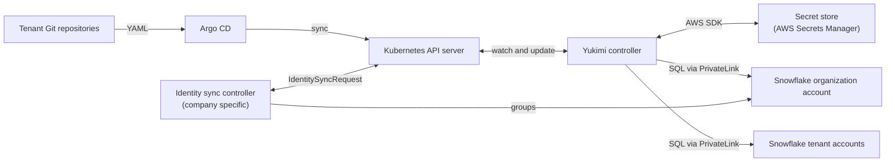
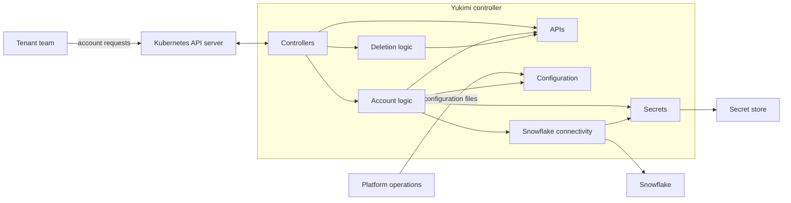
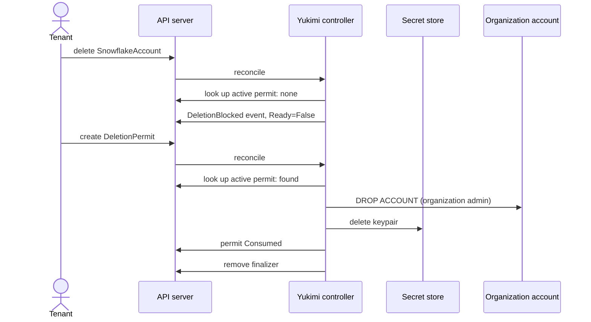

# Architecture

This document gives a human reader the big picture of Yukimi's architecture: how the parts fit
together, why they are shaped that way, and where to read further.

It is a supplement, not a source of truth. [`specs/design.md`](../specs/design.md) defines what the
platform does, and the numbered specs in [`specs/`](../specs) define what each package promises.
Where this document and either of them disagree, they win. This document summarises and links
instead of restating; it does not repeat schemas, SQL, or package APIs.

Chapter 10 (Quality Requirements) is left out on purpose: the quality goals in
[1.2](#12-quality-goals) and the guarantees in `design.md` cover it, and a separate set of quality
scenarios would only duplicate them.

- [1. Introduction and Goals](#1-introduction-and-goals)
- [2. Architecture Constraints](#2-architecture-constraints)
- [3. Context and Scope](#3-context-and-scope)
- [4. Solution Strategy](#4-solution-strategy)
- [5. Building Block View](#5-building-block-view)
- [6. Runtime View](#6-runtime-view)
- [7. Deployment View](#7-deployment-view)
- [8. Cross-cutting Concepts](#8-cross-cutting-concepts)
- [9. Architecture Decisions](#9-architecture-decisions)
- [11. Technical Debt](#11-technical-debt)

## 1. Introduction and Goals

Yukimi is a self-service platform for provisioning and managing Snowflake accounts at enterprise
scale. Every team, called a tenant, gets its own isolated Snowflake account. The account is created
from a declarative request and attached to network, identity and security infrastructure that the
platform sets up once per cloud region and shares between all accounts there.

Yukimi started as an internal platform at Allianz and has since been opened up so that other
organizations can adopt it. Company-specific choices, such as the identity system, network
connections or compliance rules, are configuration and not part of the product.

### 1.1 Requirements Overview

The table summarises the main requirements from a business point of view. The detailed
requirements are in [`specs/design.md`](../specs/design.md), linked in the last column.

| Id | Requirement | Explanation | Details |
| --- | --- | --- | --- |
| R1 | Self-service at global scale | Teams get a new Snowflake environment in minutes instead of weeks, and change it themselves. One service for thousands of teams across business units, clouds and regions, without the platform team growing with them. | [§2](../specs/design.md#2-tenant-onboarding), [§3.2](../specs/design.md#32-domain-concepts) |
| R2 | Secure and compliant by default | Every environment starts from the same hardened, approved baseline, company rules are enforced automatically, and data is protected against accidental loss. | [§3.3](../specs/design.md#33-guardrails)–[§3.11](../specs/design.md#311-security-constraints), [§6](../specs/design.md#6-deletionpermit-resource) |
| R3 | Cost control | Every team has a credit budget it cannot exceed, and spend is attributed to its cost center. | [§3.10](../specs/design.md#310-credit-quota) |
| R4 | Flexible integration | Open by design, so it can be plugged into any existing self-service landscape: GitOps, ServiceNow or a custom portal. | [§1.1](../specs/design.md#11-purpose--scope) |
| R5 | AI ready | Users build complete data products by prompting an AI agent, which deploys them directly to production. | – |

### 1.2 Quality Goals

The quality goals that shape the architecture most, in order of priority.

| Priority | Quality goal | What it means for Yukimi |
| --- | --- | --- |
| 1 | Security | Multiple independent lines of defense: no single bug, mistake or compromised tenant is enough to reach another tenant's account. |
| 2 | Reliability | The platform always moves towards the desired state, and a failure never damages an account that already works. |
| 3 | Scalability | Up to 10,000 accounts for 1,000 tenants across 10 regions, without operations effort growing at the same rate. |
| 4 | Usability | Requesting an account is simple, and feedback is clear enough for teams to fix problems themselves. |
| 5 | Performance | A new account is ready in under 60 minutes. Most of that time is spent waiting for the identity sync. |
| 6 | Operability | Operators can quickly diagnose and fix problems, for example by tracing an error to the logs through its incident ID. |
| 7 | Cost efficiency | Running the platform costs less than €50 per month per account. |
| 8 | Adaptability | Non-Allianz organizations can adopt it through configuration, without changing code. |

## 2. Architecture Constraints

Yukimi shall:

- be implemented as a Kubernetes controller in Go
- create and configure accounts through Snowflake SQL as far as possible, because SQL can be fully automated
- avoid per-account enterprise integration such as PrivateLink and DNS, because it is often not fully automated and needs tickets, and instead create such infrastructure once per region
- be open source and adoptable by other organizations

## 3. Context and Scope

### 3.1 Business Context

_To write:_ the platform as a black box and the people and processes around it: who commits CRDs,
who owns guardrails, exceptions and backplane configuration, and what each gets back. One diagram.

### 3.2 Technical Context

The controller talks to three systems directly: the Kubernetes API server, the secret store and
Snowflake. Everything else reaches it indirectly, through resources in the API server.

| Neighbour | Channel | Input and output |
| --- | --- | --- |
| Kubernetes API server | Kubernetes API | Reads `SnowflakeAccount`, `DeletionPermit` and namespace labels. Writes status, conditions, events and `IdentitySyncRequest`s. |
| Argo CD and Git | None, through the API server | Tenants' YAML arrives as custom resources in their namespace. Tenants read feedback as conditions in Argo CD. |
| Secret store | AWS SDK | Reads and writes the keypair of each account and of the organization admin. |
| Snowflake organization account | SQL via PrivateLink | Creates and deletes accounts with organization admin rights. |
| Snowflake tenant accounts | SQL via PrivateLink | Configures each account as its `platform` service user. |
| Identity sync controller | None, through the API server | Fulfils `IdentitySyncRequest`s by syncing groups into the organization account. |

See the [deployment view](#7-deployment-view) for where these run.

## 4. Solution Strategy

_To write:_ the handful of fundamental ideas the rest of the architecture follows from, one short
paragraph each, linked to where they are specified:

- integrate regions, not accounts (the shared backplane)
- the namespace as the sole trust anchor
- final enforcement sits outside the controller (secret store, Snowflake, API server)
- privilege step-down from org admin to per-account access
- account provisioning as a pipeline of independent modules
- positive control for deletion
- specs as the source of truth, code regenerable from them

## 5. Building Block View

### 5.1 Components

Yukimi is a single controller running in Kubernetes. Tenants reach it only through the Kubernetes
API server, and it reaches Snowflake and the secret store directly.

| Component | Specs | Responsibility |
| --- | --- | --- |
| APIs | 006, 016, 019 | Define the custom resources. |
| Controllers | 019, 020 | Reconcile the custom resources and report status back to the tenant. |
| Account logic | 006, 009–018 | Provisions an account step by step, with one module per concern, and derives the tenant's facts from its namespace. |
| Deletion logic | 019 | Lets an account be deleted only with an active permit, and consumes the permit when it is used. |
| Configuration | 002, 007, 008 | Loads the operations-owned base settings, backplane and guardrails. |
| Snowflake connectivity | 004, 005 | Holds the connections to the organization and to each account, and runs SQL on them. |
| Secrets | 003 | Creates, stores and reads the account keypairs in the secret store. |

Error handling and logging (001) are used by every component and are described in
[8.4](#84-error-handling-and-status-reporting).

### 5.2 Packages

Each component breaks down into Go packages. The table lists only packages that exist today. The
numbers refer to the specs in [5.3](#53-dependencies).

| Component | Packages | Description | Spec |
| --- | --- | --- | --- |
| - | `internal/errors/` `internal/logger/` | User and system errors Operation-scoped logging | 001 001 |
| APIs | `apis/base/v1alpha1/` | SnowflakeAccount and DeletionPermit types | 006, 019 |
| Controllers | `internal/controller/snowflakeaccount/` `internal/controller/deletionpermit/` | SnowflakeAccount controller DeletionPermit controller | 020 019 |
| Account logic | `internal/account/pipeline/` `internal/account/modules/account/` `internal/account/tenant/` | Module interface and outcomes Account creation Account naming and namespace labels | 009 012 006 |
| Deletion logic | `internal/deletion/` | Permit lookup and consumption | 019 |
| Configuration | `internal/config/base/` `internal/config/backplane/` | Platform-wide settings Regional backplane | 002 007 |
| Snowflake connectivity | `internal/snowflake/pool/` `internal/snowflake/host/` `internal/snowflake/statement/` | Pooled connections Hosts and account URLs SQL execution | 004 004 005 |
| Secrets | `internal/secrets/` `internal/secrets/aws/` | Secret paths, keypairs and cache AWS Secrets Manager backend | 003 003.a |

### 5.3 Dependencies

The code is generated feature by feature, and every feature is described by a spec. The specs are
written and implemented in strict numerical order, so a spec may depend only on specs with a lower
number: the higher-numbered ones do not exist yet when it is written. The packages inherit this
order. They have no cyclic dependencies, and the table below lists them in dependency order, with
each row building only on the rows above it. 

Each package is described by exactly one spec, so it is always clear which spec to update when a
package changes. A spec usually describes one package, sometimes a few. 

| Spec | Packages | Description |
| --- | --- | --- |
| [001 Error and Logging](../specs/001-error-and-logging.md) | `internal/errors/` `internal/logger/` | User and system errors, incident IDs, operation-scoped logging |
| [002 Base Config](../specs/002-base-config.md) | `internal/config/base/` | Platform-wide settings from a mounted ConfigMap |
| [003 Secrets Handling](../specs/003-secrets-handling.md) | `internal/secrets/` | Backend interface, secret paths, RSA keypairs, TTL cache |
| [003.a AWS Secrets Backend](../specs/003.a-aws-secrets-backend.md) | `internal/secrets/aws/` | AWS Secrets Manager implementation of the 003 backend |
| [004 Connection Pooling](../specs/004-connection-pooling.md) | `internal/snowflake/pool/` `internal/snowflake/host/` | Pooled keypair connections, connection hosts and account URLs |
| [005 Statement Execution](../specs/005-statement-execution.md) | `internal/snowflake/statement/` | Safe SQL rendering and execution |
| [006 SnowflakeAccount CRD](../specs/006-snowflake-account-crd.md) | `apis/base/v1alpha1/` `internal/account/tenant/` | SnowflakeAccount schema, account naming, namespace labels |
| [007 Backplane Config](../specs/007-backplane-config.md) | `internal/config/backplane/` | Per-region backplane inventory, parameters, allowlist |
| [009 Account Pipeline](../specs/009-account-pipeline.md) | `internal/account/pipeline/` | Module interface, outcomes, condition aggregation |
| [012 Account Module](../specs/012-account-module.md) | `internal/account/modules/account/` | `CREATE ACCOUNT` and platform user bootstrapping |
| [019 Deletion Permit](../specs/019-deletion-permit.md) | `apis/base/v1alpha1/` `internal/deletion/` `internal/controller/deletionpermit/` | DeletionPermit type, its lifecycle controller, permit lookup and consumption |
| [020 SnowflakeAccount Controller](../specs/020-snowflakeaccount-controller.md) | `internal/controller/snowflakeaccount/` | Module wiring, validation, deletion gate, reporting |

## 6. Runtime View

The scenarios below each involve several building blocks. The diagrams show which parts
collaborate and in what order. The detailed behaviour is in `design.md` and the specs.

Every arrow into the controller starts one reconcile pass. A pass never waits: it does what it can,
writes the result onto the resource and returns. Work that is still open is picked up by a later
pass, which Kubernetes triggers on a change or on its regular poll.

### 6.1 Creating an Account

A tenant commits a `SnowflakeAccount` to Git, and Argo CD syncs it into the tenant's namespace. The
controller sees that no account has been recorded for it yet and runs the account pipeline
([009](../specs/009-account-pipeline.md)) module by module. The admission checks run first. If the
request breaks a guardrail or does not fit the credit quota, they stop the pipeline before anything
is created.

The account module ([012](../specs/012-account-module.md)) generates the platform user's keypair,
stores it in the secret store and runs `CREATE ACCOUNT` in the organization account. It then records
the account's name, login URL and identifier on the resource. From then on the account is never
created again. A new account takes a few minutes before anyone can log in to it, so the controller
does not try to connect during a period configured by operations, because a connection would fail
anyway. 

From then on, each pass logs in to the account as the platform user, and the remaining modules
configure parameters, network, authentication, identity and quota through it. The platform user is
the administrator of its own account, but its rights end there: unlike the organization admin, it
cannot reach any other account. The organization admin is used only to create and drop accounts
(see [8.2](#82-privilege-model)).

The account becomes `Ready` the first time every module is done, and stays `Ready` from then on.

### 6.2 Waiting for an Identity Sync

A tenant gives a company group access to their account by adding it to the `SnowflakeAccount`,
either when the account is created or later. Before the group can be imported into the account, it
must exist in the organization account. Where the company does not sync all of its groups there by
default, the controller asks for them: it keeps one `IdentitySyncRequest` per identity integration
in the tenant's namespace, listing that integration's groups
([`design.md` §4](../specs/design.md#4-identitysyncrequest-resource)). A company-specific controller
fulfils the request: it adds the groups to the enterprise IAM's Snowflake sync, for example in
Azure Entra ID, and SCIM then provisions them into the organization account. Once every group has
arrived, the controller reports `Ready=True` on the request. Yukimi ships only the request, not the
controller that fulfils it.

A sync can take most of an hour, so the controller never waits for it inside a pass. Until the
groups arrive, the identity module reports the account as pending. The account is applied again on
every pass, and the groups of each fulfilled request are imported as soon as it reports `Ready`.
The `IdentitySynced` condition shows the wait. If the wait runs past a configured timeout, the
reason changes from `SyncPending` to `SyncTimeout` with a warning event for operators, but the
controller keeps trying.

The diagram shows a group added to an account that is already `Ready`, which stays `Ready`
throughout. For a new account the first sync also holds `Ready` at false, because nobody can
administer the account before the group bound to `ACCOUNTADMIN` has been imported.

### 6.3 Deleting an Account

Deleting a `SnowflakeAccount`, for example by removing its file from Git, does not delete the
account by itself. A finalizer holds the resource in `Terminating`, and the controller looks for an
active `DeletionPermit` for it in the same namespace ([019](../specs/019-deletion-permit.md)). If
there is none, the controller refuses, records a `DeletionBlocked` warning event and sets
`Ready=False`, which Argo CD reports as a failure. The tenant then either restores the file or
creates a permit.

A permit names the account, gives a reason and is valid for at most eight hours. A separate
controller marks it `Expired` when the window closes unused. With an active permit, the pipeline
tears the account down, running the modules in reverse. The account is dropped last, and the
platform user's key is deleted with it. Both can be restored for a period configured by operations.
Only after the teardown has succeeded is the permit marked `Consumed` and the finalizer removed, so
a failed teardown can be retried with the same permit while it is still active. The consumed permit stays as an audit record.

A resource whose account was never created, for example because its name failed validation, is
removed without a permit. Operations can also switch deletion protection off for the whole platform
in the base configuration.

## 7. Deployment View

### 7.1 Production

_To write:_ what runs where: the controller deployment in its cluster, the mounted configuration,
tenant namespaces, the secret store, and the Snowflake organization with its regional backplanes
and PrivateLink endpoints. Links to the manifests in [`package/`](../package).

### 7.2 Local Development

_To write:_ the kind cluster started by `make dev`. Details in [development.md](development.md).

## 8. Cross-cutting Concepts

_To write:_ concepts that span several packages, each as a short summary that links to the spec or
`design.md` section that owns it.

### 8.1 Tenancy and Isolation

_To write:_ the namespace trust anchor, secret paths, and why a controller bug yields a denied
request rather than cross-tenant access.

### 8.2 Privilege Model

_To write:_ org-admin versus per-account credentials, and when each is used.

### 8.3 Configuration Ownership

_To write:_ the inputs and who owns each: CRD (tenant), guardrails (OEs), exceptions (ISO and ops),
backplane and base config (ops), namespace labels (ops at onboarding).

### 8.4 Error Handling and Status Reporting

_To write:_ user versus system errors, incident IDs, and the condition model (`Ready`, `Synced` and
resource-specific conditions).

### 8.5 Reconciliation Model

_To write:_ idempotent, level-triggered reconciliation, no retries in controller code, and the
latching `Ready` condition.

### 8.6 Naming and Identifiers

_To write:_ CRD name versus resolved Snowflake name, and which identifier is used where.

## 9. Architecture Decisions

_To write:_ the significant decisions, one short entry each: context, decision, consequence, and a
link to where it is specified. Candidates: Crossplane runtime without being a community provider,
spec-driven development, namespace-hash account naming, positive-control deletion,
`IdentitySyncRequest` in its own API group, a pluggable secret store backend.

## 11. Technical Debt

- **OIDC authentication.** The controller reaches tenant accounts only with the `platform` user's
  key pair from the secret store. The optional OIDC path, which avoids reading that key on every
  connection, is still open ([`design.md` 3.11.2](../specs/design.md#3112-oidc-authentication-optional-todo)).
