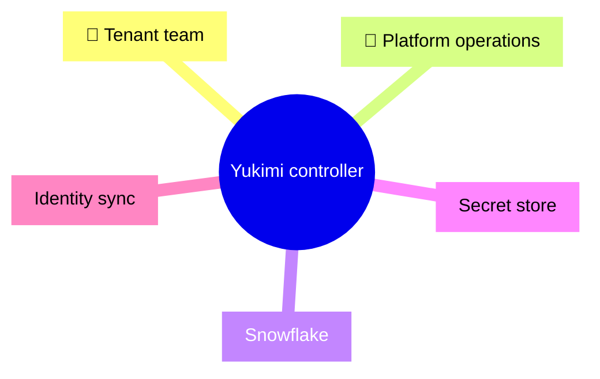
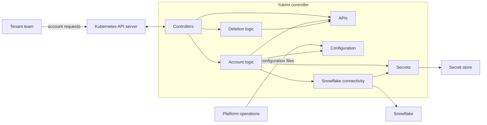
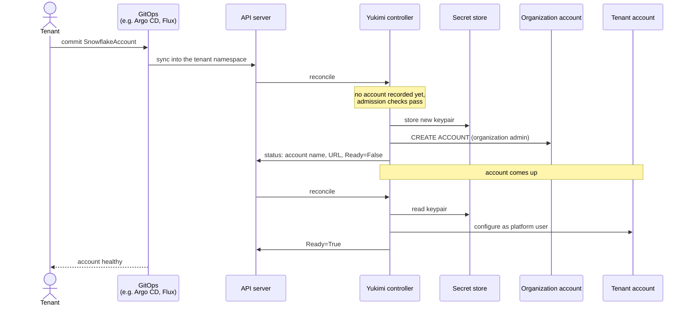
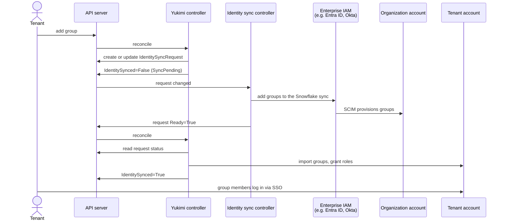
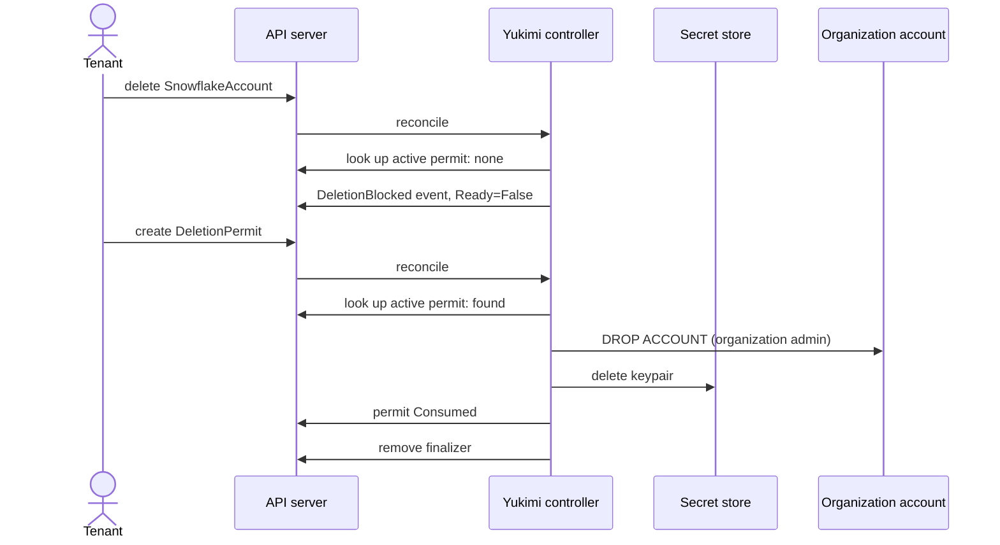

# Architecture

This document gives a human reader the big picture of Yukimi's architecture: how the parts fit
together, why they are shaped that way, and where to read further. The source of truth is
[`specs/design.md`](../specs/design.md) and the numbered specs in [`specs/`](../specs); where they
disagree with this document, they win.

- [1. Introduction](#1-introduction)
- [2. Quality Goals](#2-quality-goals)
- [3. Context and Scope](#3-context-and-scope)
- [4. Solution Strategy](#4-solution-strategy)
- [5. Building Block View](#5-building-block-view)
- [6. Runtime View](#6-runtime-view)
- [7. Deployment View](#7-deployment-view)
- [8. Cross-cutting Concepts](#8-cross-cutting-concepts)

## 1. Introduction

Yukimi is a self-service platform for provisioning and managing Snowflake accounts at enterprise
scale. Every team, called a tenant, gets its own isolated Snowflake account. The account is created
from a declarative request and attached to network, identity and security infrastructure that the
platform sets up once per cloud region and shares between all accounts there.

Yukimi started as an internal platform at Allianz and has since been opened up so that other
organizations can adopt it. Company-specific choices, such as the identity system, network
connections or compliance rules, are configuration and not part of the product.

### 1.1 Requirements Overview

The table summarises the main requirements from a business point of view. The detailed
requirements are in [`specs/design.md`](../specs/design.md), linked in the last column.

| Id | Requirement | Explanation | Details |
| --- | --- | --- | --- |
| R1 | Self-service at global scale | Teams get a new Snowflake environment in minutes instead of weeks, and change it themselves. One service for thousands of teams across business units, clouds and regions, without the platform team growing with them. | [§2](../specs/design.md#2-tenant-onboarding), [§3.2](../specs/design.md#32-domain-concepts) |
| R2 | Secure and compliant by default | Every environment starts from the same hardened, approved baseline, company rules are enforced automatically, and data is protected against accidental loss. | [§3.3](../specs/design.md#33-guardrails)–[§3.11](../specs/design.md#311-security-constraints), [§6](../specs/design.md#6-deletionpermit-resource) |
| R3 | Cost control | Every team has a credit budget it cannot exceed, and spend is attributed to its cost center. | [§3.10](../specs/design.md#310-credit-quota) |
| R4 | Flexible integration | Open by design, so it can be plugged into any existing self-service landscape: GitOps (e.g. Argo CD, Flux), ServiceNow or a custom portal. | [§1.1](../specs/design.md#11-purpose--scope) |
| R5 | AI ready | Users build complete data products by prompting an AI agent, which deploys them directly to production. | – |

## 2. Quality Goals

The quality goals that shape the architecture most, in order of priority.

| Priority | Quality goal | What it means for Yukimi |
| --- | --- | --- |
| 1 | Security | Multiple independent lines of defense: no single bug, mistake or compromised tenant is enough to reach another tenant's account. |
| 2 | Reliability | A crash, restart or failover of the controller never damages, duplicates or loses an account. After a 10-minute chaos monkey test, all accounts reach a healthy end state. |
| 3 | Scalability | Up to 10,000 accounts for 1,000 tenants across 10 regions, without operations effort growing at the same rate. |
| 4 | Usability | Teams request an account without training or reading the documentation. In a UX test with 10 users, each gets a working account on their own, making at most one mistake on average and fixing it from the error message alone. |
| 5 | Performance | A new account is ready in under 60 minutes. Most of that time is spent waiting for the identity sync. |
| 6 | Operability | Operators trace a deliberately introduced system error to its cause within 15 minutes, starting from the incident ID in the resource's status. |
| 7 | Cost efficiency | Running the platform costs less than €10 per month per account. |
| 8 | Testability | Code coverage of 95% from unit tests, 80% from integration tests in packages that talk to Snowflake or AWS, and 70% from end-to-end tests. |

## 3. Context and Scope

People and the identity sync reach the controller through Kubernetes, and the controller reaches
Snowflake and the secret store directly.

| Neighbour | Input and output |
| --- | --- |
| Tenant team | Requests, changes and deletes accounts with `SnowflakeAccount`. |
| Platform operations | Provisions the regional backplane and maintains its network inventory, together with the platform settings, in a ConfigMap. Onboards tenant teams by creating and labelling their namespaces. |
| Snowflake | Provisions and deletes accounts through the central organization account. Configures each tenant account with its own `platform` service user. |
| Secret store | Reads and writes the keypair of each account and of the organization admin. A pluggable interface allows different stores, e.g. AWS Secrets Manager, Azure Key Vault, GCP Secret Manager or HashiCorp Vault. The store stays necessary with OIDC too, because an account can only be created with a keypair. |
| Identity sync | A company-specific controller that syncs the requested groups into the organization account and reports when they have arrived. |

See the [deployment view](#7-deployment-view) for where these run.

## 4. Solution Strategy

Creating an account has to run without a human in the loop, so it contains only steps that
Snowflake SQL can perform. Everything that is hard to automate, because it needs tickets, other
teams or manual testing, is moved out of the account request and done once, in advance, by
operations:

- **Network.** PrivateLink endpoints and DNS wildcards are set up once per region as a shared
  backplane, and tested before the region is offered to tenants. A new account only attaches to
  this backplane with SQL
  ([`design.md` §3.2](../specs/design.md#32-domain-concepts), [§3.5](../specs/design.md#35-backplane-config)).
- **Identity.** SSO is integrated once for the whole organization, in the central organization
  account. A new account does not get its own identity provider integration; it imports the groups
  it needs from the organization account
  ([§3.7](../specs/design.md#37-identity-integration)).

As a result, operations effort grows with the number of regions rather than the number of accounts
([quality goal 3](#2-quality-goals)), and bringing a region online is a project while ordering an
account is not.

## 5. Building Block View

### 5.1 Components

Yukimi is a single controller running in Kubernetes. Tenants reach it only through the Kubernetes
API server, and it reaches Snowflake and the secret store directly.

| Component | Specs | Responsibility |
| --- | --- | --- |
| APIs | 006, 016, 019 | Define the custom resources. |
| Controllers | 019, 020 | Reconcile the custom resources and report status back to the tenant. |
| Account logic | 006, 009–018 | Provisions an account step by step, with one module per concern, and derives the tenant's facts from its namespace. |
| Deletion logic | 019 | Lets an account be deleted only with an active permit, and consumes the permit when it is used. |
| Configuration | 002, 007, 008 | Loads the operations-owned base settings, backplane and guardrails. |
| Snowflake connectivity | 004, 005 | Holds the connections to the organization and to each account, and runs SQL on them. |
| Secrets | 003 | Creates, stores and reads the account keypairs in the secret store. |

Error handling and logging (001) are used by every component and are described in
[8.3](#83-error-handling-and-status-reporting).

### 5.2 Packages

Each component breaks down into Go packages. The table lists only packages that exist today. The
numbers refer to the specs in [5.3](#53-dependencies).

| Component | Packages | Description | Spec |
| --- | --- | --- | --- |
| - | `internal/errors/` `internal/logger/` | User and system errors Operation-scoped logging | 001 001 |
| APIs | `apis/base/v1alpha1/` | SnowflakeAccount and DeletionPermit types | 006, 019 |
| Controllers | `internal/controller/snowflakeaccount/` `internal/controller/deletionpermit/` | SnowflakeAccount controller DeletionPermit controller | 020 019 |
| Account logic | `internal/account/pipeline/` `internal/account/modules/account/` `internal/account/tenant/` | Module interface and outcomes Account creation Account naming and namespace labels | 009 012 006 |
| Deletion logic | `internal/deletion/` | Permit lookup and consumption | 019 |
| Configuration | `internal/config/base/` `internal/config/backplane/` | Platform-wide settings Regional backplane | 002 007 |
| Snowflake connectivity | `internal/snowflake/pool/` `internal/snowflake/host/` `internal/snowflake/statement/` | Pooled connections Hosts and account URLs SQL execution | 004 004 005 |
| Secrets | `internal/secrets/` `internal/secrets/aws/` | Secret paths, keypairs and cache AWS Secrets Manager backend | 003 003.a |

### 5.3 Dependencies

The code is generated feature by feature, and every feature is described by a spec. The specs are
written and implemented in strict numerical order, so a spec may depend only on specs with a lower
number: the higher-numbered ones do not exist yet when it is written. The packages inherit this
order. They have no cyclic dependencies, and the table below lists them in dependency order, with
each row building only on the rows above it. 

Each package is described by exactly one spec, so it is always clear which spec to update when a
package changes. A spec usually describes one package, sometimes a few. 

| Spec | Packages | Description |
| --- | --- | --- |
| [001 Error and Logging](../specs/001-error-and-logging.md) | `internal/errors/` `internal/logger/` | User and system errors, incident IDs, operation-scoped logging |
| [002 Base Config](../specs/002-base-config.md) | `internal/config/base/` | Platform-wide settings from a mounted ConfigMap |
| [003 Secrets Handling](../specs/003-secrets-handling.md) | `internal/secrets/` | Backend interface, secret paths, RSA keypairs, TTL cache |
| [003.a AWS Secrets Backend](../specs/003.a-aws-secrets-backend.md) | `internal/secrets/aws/` | AWS Secrets Manager implementation of the 003 backend |
| [004 Connection Pooling](../specs/004-connection-pooling.md) | `internal/snowflake/pool/` `internal/snowflake/host/` | Pooled keypair connections, connection hosts and account URLs |
| [005 Statement Execution](../specs/005-statement-execution.md) | `internal/snowflake/statement/` | Safe SQL rendering and execution |
| [006 SnowflakeAccount CRD](../specs/006-snowflake-account-crd.md) | `apis/base/v1alpha1/` `internal/account/tenant/` | SnowflakeAccount schema, account naming, namespace labels |
| [007 Backplane Config](../specs/007-backplane-config.md) | `internal/config/backplane/` | Per-region backplane inventory, parameters, allowlist |
| [009 Account Pipeline](../specs/009-account-pipeline.md) | `internal/account/pipeline/` | Module interface, outcomes, condition aggregation |
| [012 Account Module](../specs/012-account-module.md) | `internal/account/modules/account/` | `CREATE ACCOUNT` and platform user bootstrapping |
| [019 Deletion Permit](../specs/019-deletion-permit.md) | `apis/base/v1alpha1/` `internal/deletion/` `internal/controller/deletionpermit/` | DeletionPermit type, its lifecycle controller, permit lookup and consumption |
| [020 SnowflakeAccount Controller](../specs/020-snowflakeaccount-controller.md) | `internal/controller/snowflakeaccount/` | Module wiring, validation, deletion gate, reporting |

## 6. Runtime View

The scenarios below each involve several building blocks. The diagrams show which parts
collaborate and in what order. The detailed behaviour is in `design.md` and the specs.

Every arrow into the controller starts one reconcile pass. A pass never waits: it does what it can,
writes the result onto the resource and returns. Work that is still open is picked up by a later
pass, which Kubernetes triggers on a change or on its regular poll.

### 6.1 Creating an Account

A tenant commits a `SnowflakeAccount` to Git, and the GitOps tool (e.g. Argo CD, Flux) syncs it
into the tenant's namespace. The controller sees that no account has been recorded for it yet and
runs the account pipeline ([009](../specs/009-account-pipeline.md)) module by module. The admission
checks run first. If the request breaks a guardrail or does not fit the credit quota, they stop the
pipeline before anything is created.

The account module ([012](../specs/012-account-module.md)) generates the platform user's keypair,
stores it in the secret store and runs `CREATE ACCOUNT` in the organization account. It then records
the account's name, login URL and identifier on the resource. From then on the account is never
created again. A new account takes a few minutes before anyone can log in to it, so the controller
does not try to connect during a period configured by operations, because a connection would fail
anyway. 

From then on, each pass logs in to the account as the platform user, and the remaining modules
configure parameters, network, authentication, identity and quota through it. The account becomes `Ready` the first time every module is done, and stays `Ready` from then on.

### 6.2 Waiting for an Identity Sync

A tenant gives a company group access to their account by adding it to the `SnowflakeAccount`,
either when the account is created or later. Before the group can be imported into the account, it
must exist in the organization account.

Every company connects its IAM to Snowflake differently, so Yukimi does not do the sync itself. It
only says what it needs, in a single `IdentitySyncRequest` listing the account's groups
([`design.md` §4](../specs/design.md#4-identitysyncrequest-resource)), and leaves the how to a
company-specific controller. That controller adds the groups to the IAM, e.g. the Snowflake
enterprise app in Entra ID. SCIM then delivers the groups to the organization
account in the background, which can take up to an hour. Yukimi therefore waits a while and then
tries the import on every pass until it works.

### 6.3 Deleting an Account

Deleting a `SnowflakeAccount`, for example by removing its file from Git, does not delete the
account by itself. A finalizer holds the resource in `Terminating`, and the controller looks for an
active `DeletionPermit` for it in the same namespace ([019](../specs/019-deletion-permit.md)). If
there is none, the controller refuses, records a `DeletionBlocked` warning event and sets
`Ready=False`, which the GitOps tool reports as a failure. The tenant then either restores the file or
creates a permit.

A permit names the account, gives a reason and is valid for at most eight hours. A separate
controller marks it `Expired` when the window closes unused. With an active permit, the pipeline
tears the account down, running the modules in reverse. The account is dropped last, and the
platform user's key is deleted with it. Both can be restored for a period configured by operations.
Only after the teardown has succeeded is the permit marked `Consumed` and the finalizer removed, so
a failed teardown can be retried with the same permit while it is still active. The consumed permit stays as an audit record.

## 7. Deployment View

One controller in one Kubernetes cluster serves every region. Tenants share the cluster, each in
their own namespace, and the controller reaches the secret store and every Snowflake region from
there. The diagram shows the AWS reference setup.

| Element | Description |
| --- | --- |
| Yukimi controller | Installed from `install.yaml`, rendered from [`package/`](../package). Runs as a single replica, because `CREATE ACCOUNT` is not idempotent and two controllers must never act on the same resource. |
| `yukimi-config` ConfigMap | `base.yaml` ([002](../specs/002-base-config.md)) and `backplane.yaml` ([007](../specs/007-backplane-config.md)), mounted read-only. Applied separately from `install.yaml`, so an upgrade never overwrites it. Read once at startup, so a change takes effect only after a restart. |
| IAM role | The controller's only cloud credential, taken from the pod's identity and limited to its own secret paths. |
| Secrets Manager | The organization admin keypair, stored by operations, and one keypair per tenant account, stored by the controller. |
| PrivateLink endpoint | One per region with a DNS wildcard, shared by all accounts there and set up once by operations. The cluster must reach the endpoint of every region in the backplane. A new region needs a backplane entry ([`design.md` §3.5](../specs/design.md#35-backplane-config)), not a new deployment. |
| Tenant accounts | The tenants' Snowflake accounts. The controller connects to each one directly through its region's endpoint. |
| Custom resources | The tenant's resources, e.g. `SnowflakeAccount`, synced by GitOps into the tenant's namespace. Operations creates and labels the namespace at onboarding. |

## 8. Cross-cutting Concepts

The concepts below apply to several building blocks at once. Each section summarises the idea and
links to the spec or `design.md` section that owns the details.

### 8.1 Tenancy and Isolation

The Kubernetes namespace is the tenancy boundary. Operations creates and labels it at onboarding,
and tenants can neither rename it, move resources into another one nor change its labels. The
platform therefore trusts the namespace and its labels, such as department, cost center and credit
quota, but nothing a tenant writes into a `SnowflakeAccount`
([006](../specs/006-snowflake-account-crd.md), [`design.md` §3.11.1](../specs/design.md#3111-tenant-isolation-via-secret-paths)).

The namespace is also part of the identifier under which each account's keypair is stored,
`yk-<org>--<namespace>--<account>` ([003](../specs/003-secrets-handling.md)). The controller takes
the namespace from where the resource lives, never from its spec. A tenant can therefore only reach
the credentials of accounts in its own namespace, and with them only its own Snowflake accounts.
Two tenants can both name an account `analytics` without ever touching each other's.

The aim is that the final check always sits outside the controller, so that a bug in the controller
yields a denied request rather than cross-tenant access. Today this holds in two places: the
Kubernetes API server keeps tenants inside their namespace, and Snowflake limits each tenant
connection to its own account ([8.2](#82-privilege-model)). The secret store does not hold it yet.
The controller has a single role that can read every tenant's secret, so the identifier scheme
protects against tenants, but not against a controller bug that builds the wrong identifier
([003](../specs/003-secrets-handling.md#security-considerations)). OIDC is meant to close this gap,
by letting Snowflake itself verify which namespace a connection comes from
([`design.md` §3.11.2](../specs/design.md#3112-oidc-authentication-optional-todo)).

### 8.2 Privilege Model

The controller uses two kinds of credential and keeps them strictly apart
([`design.md` §3.11](../specs/design.md#311-security-constraints),
[004](../specs/004-connection-pooling.md)).

| Identity | Used for |
| --- | --- |
| Organization admin | Creating and dropping accounts in the organization account, and nothing else. |
| Platform user, one per account | Everything inside the account: parameters, network, authentication, identity and quota. |

Right after creating an account, the controller steps down from the organization admin to the
account's own platform user. This is a service user without a password that Snowflake makes the
account's first administrator, and only the platform holds its key
([012](../specs/012-account-module.md)). The two kinds of connection are requested through separate
entry points, and only the account module asks for the organization connection, so no other module
can get it by mistake. Whatever goes wrong on a tenant connection can at most affect that one
account.

The organization credential is also kept out of routine passes. The controller records an account's
existence on the resource instead of asking Snowflake for it ([8.4](#84-reconciliation-model)), so
the regular poll needs no organization-wide access. Only creating and dropping an account need it.

Platform user keys are rotated over the open connection once they reach a configured age. Snowflake
accepts two keys per user, so the new key is registered next to the old one and the working key is
never lost ([004](../specs/004-connection-pooling.md)). One gap remains: a tenant who holds
`ACCOUNTADMIN` can drop or re-key the platform user and lock the platform out. Closing it needs
Snowflake's Organization Policies
([`design.md` Appendix B, X1](../specs/design.md#b5-platform-access)).

### 8.3 Error Handling and Status Reporting

Every error is either a user error or a system error
([001](../specs/001-error-and-logging.md)).

| | User error | System error |
| --- | --- | --- |
| Cause | A mistake in the resource that the tenant can fix, e.g. an unknown region or a malformed CIDR. | A failure in the infrastructure that an operator must fix, e.g. Snowflake or the secret store is unreachable. |
| Shown on the resource | The message itself, saying what to correct. | `An internal error occurred (f47ac10b)`: an incident ID, without internal details. |
| Logged | Only at debug level. | Always, with the incident ID and the full details. |

Business logic only classifies an error. The controller turns it into a status message and a log
entry in one place. Every log entry carries the tenant namespace, the resource and the operation,
so operators can filter on them instead of searching message text.

Tenants never see the controller's logs, so the resource is their only feedback
([020](../specs/020-snowflakeaccount-controller.md#key-concept-the-resource-is-the-tenants-only-feedback)).
Every resource reports two standard conditions
([`design.md` §7.1](../specs/design.md#71-condition-model)):

- **`Ready`**: the resource has been provisioned and can be used.
- **`Synced`**: the last pass ran without an error. If it did not, the condition carries the error
  message.

A resource adds conditions of its own for states that are neither an error nor a lack of
readiness. `SnowflakeAccount` reports `QuotaAvailable=False` when its credits are used up and
`IdentitySynced=False` while groups are still being synced. Notable moments, such as running out
of credits or a blocked deletion, are also recorded as Kubernetes events. GitOps tools read the
same conditions to show an account as healthy or failing.

### 8.4 Reconciliation Model

The controller works from the current state, not from individual changes. Whether it is woken by
an edit, a restart or the regular poll, it does the same thing: it compares the whole resource with
what it knows about the account and fixes whatever differs. It never needs to know what changed or
why, so a missed or repeated trigger does no harm. Each pass observes first and then creates the account, updates it or leaves it alone
([009](../specs/009-account-pipeline.md#key-concept-the-reconcile-loop)). Create and update are
the same declarative apply, which works on a missing, a half-created and a fully provisioned
account alike. A pass interrupted at any point is therefore simply finished by the next one.
Teardown steps are safe to repeat as well.

The work is done by a pipeline of modules, one per concern. Each module reports one of four
outcomes: done, pending, drifted or failed. Pending means an expected wait, such as an account
still coming up or a group still being synced, and is not an error. The pipeline derives everything
the controller reports from these outcomes, and the controller works nothing out itself.

No pass waits, and no controller code retries. A failure is returned to Kubernetes as an error,
and Kubernetes runs the pass again later. A wait is picked up by a later pass. If observing fails,
nothing is created or updated in that pass.

Kubernetes, not Snowflake, is the source of truth for whether an account exists. Right after
`CREATE ACCOUNT`, the controller records the account's identifier on the resource. From then on the
account is never created again. If it goes missing, the controller reports this instead of
recreating it ([012](../specs/012-account-module.md#key-concept-existence-is-recorded-not-looked-up)).

`Ready` latches. It turns true the first time every module is done, and stays true afterwards. A
later change that cannot be applied, or drift in Snowflake, shows on `Synced` and does not take
`Ready` away, because the account itself still works ([quality goal 2](#2-quality-goals)). The
one exception is a blocked deletion, which sets `Ready=False` so that the GitOps tool reports it
([6.3](#63-deleting-an-account)).

### 8.5 Naming and Identifiers

An account has several identifiers. The tenant chooses the name of the resource, and Snowflake
assigns its own locator. Snowflake also needs a name that is unique across the whole organization.
Tenants can't see each other's namespaces, so two of them picking the same name is normal. A suffix
hashed from the namespace keeps their Snowflake names apart
([`design.md` §3.12](../specs/design.md#312-account-naming)).

| Identifier | Example | Derived from | Used for |
| --- | --- | --- | --- |
| CRD name | `analytics-team-eu` | `metadata.name`, chosen by the tenant | Everything on the Kubernetes and configuration side: guardrail targets, approved exceptions, deletion permits, identity sync requests and replication. |
| Snowflake name | `analytics_team_eu_5k3wf` | The CRD name with `-` turned into `_`, plus a suffix hashed from the namespace | Display only: the account's name in the Snowflake UI. |
| Locator | `xy12345` | Assigned by Snowflake at `CREATE ACCOUNT` and recorded in the status | The connection host and the login URL. |
| Secret identifier | `yk-my-org--finance--analytics-team-eu` | Organization, namespace and CRD name | The account's keypair in the secret store. |
