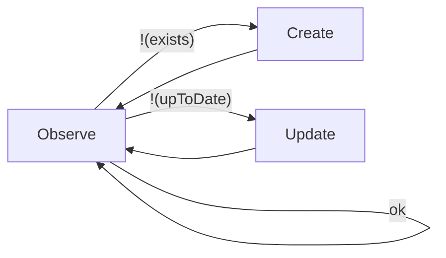
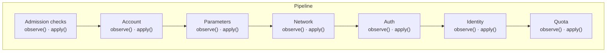

# Specification: Account Pipeline (009)

## Overview

Creating and updating a Snowflake account is split into modules, one per concern: admission checks,
the account itself, parameters, network, authentication, identity and quota. The pipeline defines the
contract every module follows and runs the modules in a fixed order. Each module can therefore be
tested on its own, and the pipeline is extended by adding a module, without changing the controller or
the other modules.


## Key Concept: The Reconcile Loop 

A SnowflakeAccount is a Kubernetes resource that describes a Snowflake account, and a controller keeps
the real account in line with it. The controller reconciles the resource whenever it changes and
again on a regular poll. Each reconcile first observes the account and then creates it, updates it, or
leaves it unchanged. Deleting the resource deletes the account.

Every reconcile begins with two questions: does the account exist, and does it still match the spec?
A missing account is created, an account that differs from the spec is updated, and
an account that matches is left unchanged. If observing fails, neither question is answered, so
nothing is created or updated and the next reconcile observes again.



## Key Concept: The Controller Delegates to a Pipeline of Modules

Provisioning an account spans many separate concerns, and handling them all in the controller would
make it hard to follow and test. The controller therefore delegates this work to a pipeline and keeps
only the Kubernetes-facing responsibilities. The pipeline exposes three operations: observe, which
answers the two questions above; apply, which creates or updates the account; and destroy.

The pipeline is built from modules, one per concern: admission checks, account creation, parameters,
network, auth, identity and quota. Each step runs through the modules one at a time in a fixed order,
and destruction runs through them in reverse. Modules never call each other, so each concern can be
built and tested on its own.



The controller's create and update both delegate to the pipeline's single apply operation, because
apply is implemented declaratively. In other words, apply works on a missing account, on an account
whose creation was interrupted, and on a fully provisioned account.

Apply runs every module, even after one fails, unless a module stops it because nothing after it could
succeed. Admission checks stop it when the request is not allowed, so no account is created.


## Key Concept: Every Module Reports One of Four Outcomes

Whenever the pipeline observes or applies a module, the module answers with one of four outcomes. The
set is small and fixed, so the pipeline can summarize a whole pass without knowing what any module
actually does, and a new module fits in without changing the pipeline or the controller.

- **Done**: the module's part of the account is in place and matches the spec. Nothing is left to do.
- **Pending**: the module's part is not in place yet, but that is expected and will settle without
  anyone acting, like an account still coming up or a group still being imported. The module says why
  it is waiting, and the account is not reported ready until it settles. Pending is not an error.
- **Drifted**: the module's part exists but no longer matches the spec, for example because someone
  changed it directly in Snowflake. Only observing detects drift. It marks the account as out of date,
  so the next apply restores what the spec says.
- **Failed**: something went wrong that will not resolve by waiting, and someone must act: the tenant
  by fixing the spec, or an operator by fixing the infrastructure. The error is reported on the
  resource.


## Key Concept: From Module Outcomes to Controller State

After observing or applying, the pipeline holds one outcome for each module that ran. From this list
it derives the four values the controller reports. Two of them steer the reconcile and are never shown
to the tenant: whether the account **exists** and whether it is **up to date**. The other two are
conditions on the resource's status that the tenant sees: **Ready** and **Synced**. The controller
uses these values as they are and works nothing out itself.

- **Exists**: is there an account at all? Only the account module decides this. If the account is
  missing or still coming up, the controller creates it.
- **Up to date**: is there work left? The account is up to date when the last apply completed with
  every module Done for the current spec and no module has drifted since. Otherwise the controller
  updates it.
- **Ready**: has the account ever been fully provisioned? Ready turns true the first time an apply
  completes with every module Done, and stays true from then on. Until then it is false and shows
  the first reason for waiting.
- **Synced**: did this pass hit an error? Synced is true unless a module failed, in which case it shows
  the first failure.

Each value is computed from the outcomes of all modules. Each row below is a separate example pass:

| Controller state | Account module | Parameters module | Network module | Identity module | Result |
|------------------|:--------------:|:-----------------:|:--------------:|:---------------:|:------:|
| Exists           | Done           | –                 | –              | –               | true   |
| Exists           | Pending        | –                 | –              | –               | false  |
| Up to date       | Done           | Done              | Done           | Done            | true   |
| Up to date       | Done           | Done              | Drifted        | Done            | false  |
| Ready            | Done           | Done              | Done           | Done            | true   |
| Ready            | Done           | Done              | Done           | Pending         | false  |
| Synced           | Done           | Done              | Done           | Pending         | true   |
| Synced           | Done           | Done              | Failed         | Done            | false  |

Synced and up to date are easy to confuse but answer different questions. Synced is only about errors,
up to date is about work left. A group that is still being imported leaves the account Synced but not
up to date: nothing has gone wrong, yet the account is applied again on the next pass.


## Key Concept: Teardown in Reverse

Destroying an account runs through the modules in reverse order. Each module removes only what would
outlive the account. Most have nothing to remove, because dropping the account takes everything inside
it along, so the account itself is dropped last. The first failure stops the teardown. Every step is
safe to repeat, so the next attempt simply starts again from the beginning.

A dropped account stays restorable for a grace period, together with its credential, and its name stays reserved until
the period ends.


## Public API

```go
package pipeline

// State is the fixed vocabulary every Outcome reports through.
type State int

const (
    StateDone    State = iota // provisioned and matches the spec
    StatePending              // not yet provisioned; Reason says why (Ready=False)
    StateDrifted              // Observe only: provisioned, but differs from the spec
    StateFailed               // Err is set; user vs system is decided by the error itself
)

// Outcome is everything one module reports from one Observe or Apply call.
type Outcome struct {
    Module    string          // set by the pipeline, never by the module
    State     State
    Reason    string          // Pending: why it is waiting; becomes Ready's message
    Err       error           // Failed: errors.NewUserError(...) or a wrapped system error
    Aborted   bool            // set via Abort(): Apply stops after this module on this pass
    Condition *xpv1.Condition // optional: a condition this module owns
    Events    []event.Event   // optional: zero or more events
}

func Done() Outcome
func Pending(reason string) Outcome
func Drifted() Outcome
func Failed(err error) Outcome

// Abort returns o with Aborted set; a no-op on a Done outcome, so a stopped
// run is never complete. Observe ignores it.
func (o Outcome) Abort() Outcome
func (o Outcome) WithCondition(c xpv1.Condition) Outcome
func (o Outcome) WithEvent(e event.Event) Outcome

// Module is implemented by each pipeline stage (010, 011, 012, 013, 014, 015, 017, 018).
type Module interface {
    Name() string

    // Observe is read-back only; it must mutate nothing in Snowflake (it may set
    // status fields on the CR). Done: provisioned and matches the spec. Pending:
    // not yet provisioned. Drifted: provisioned, but differs from the spec.
    // Failed: could not read back — the exception; domain checks belong in Apply.
    Observe(ctx context.Context, data *ResourceData) Outcome

    // Apply re-asserts this module's full desired state, pruning any object the
    // CRD no longer lists. It must be safe to call repeatedly with no other call
    // in between (Key Concept: Overwrite Apply). Drifted from Apply counts as
    // not Done.
    Apply(ctx context.Context, data *ResourceData) Outcome

    // Teardown removes the state this module leaves outside the tenant's own
    // account, which dropping that account would not take with it. Most
    // modules have none and return nil. It uses OrgAdminDB or no connection at
    // all — never TenantDB — and must be safe to call repeatedly (Key Concept:
    // Reverse-Order Teardown).
    //
    // A nil error means the removal was accepted, not necessarily that the
    // object is gone: a vendor may keep it restorable, and its name reserved,
    // for a grace period. Nothing here reports such a deadline, deliberately.
    Teardown(ctx context.Context, data *ResourceData) error
}

// AccountModuleName is the account module's (012) Name(). Observation uses it
// to find which module's outcome decides whether the resource exists,
// regardless of that module's position in the registered list.
const AccountModuleName = "account"


// Pipeline runs an ordered list of modules against one ResourceData per call.
type Pipeline struct{ /* unexported */ }

// New builds a pipeline from an ordered module list, e.g.
// New(guardrailcheck, account, network, auth). Registration order is
// execution order for Observe and Apply, and its reverse for Destroy. Exactly one module must be the
// account module, identified by Name() == AccountModuleName: its Observe
// outcome is the sole source of whether the resource exists, and every module that
// calls ResourceData.TenantDB must be registered after it, since TenantDB
// requires the locator only its Apply sets. The account module need not be
// registered first overall — a module needing no Snowflake connection (for
// example, an admission gate like guardrail-check or quota-check that must
// abort before the account is ever created) may run earlier.
func New(modules ...Module) *Pipeline

// Observe calls every module's Observe in order and collects the outcomes. It
// performs no mutation of its own and never stops early. A module's failure
// is in its Outcome; Observation.Err() returns the first one.
func (p *Pipeline) Observe(ctx context.Context, data *ResourceData) Observation

// Apply calls every module's Apply in order, stopping early only after an
// outcome marked Abort. It sets status.observedGeneration (through
// data.CR()) iff the run completed. It is idempotent by construction (Key
// Concept: Overwrite Apply) — callers may call it from both a create and an
// update path with identical behavior.
func (p *Pipeline) Apply(ctx context.Context, data *ResourceData) Result

// Destroy calls every module's Teardown in reverse registration order, so
// every module registered after the account module tears down before the
// account itself is dropped (Key Concept: Reverse-Order Teardown).
//
// A nil return means every teardown was accepted. It does not mean the
// external state is gone: the account and its credential may both still be
// inside their restore windows (Key Concept: Reverse-Order Teardown).
//
// Returns:
//   - error: the first Teardown error, returned unchanged and already
//     classified by the module that produced it. No later Teardown runs.
func (p *Pipeline) Destroy(ctx context.Context, data *ResourceData) error

// Outcomes is every module's Outcome from one run, in execution order. All
// derived values are computed here, nowhere else.
type Outcomes []Outcome

func (o Outcomes) Err() error                   // first Failed outcome's Err, or nil
func (o Outcomes) AllDone() bool                // non-empty and every entry is Done
func (o Outcomes) Conditions() []xpv1.Condition // every module-owned condition, in order
func (o Outcomes) Events() []event.Event        // every event, in order
func (o Outcomes) PendingReason() string        // first Pending outcome's Reason, or ""; Failed never contributes

// Observation is Pipeline.Observe's result.
type Observation struct {
    Outcomes
    /* unexported: generation applied and Ready already latched, both
       snapshotted at the start of the run */
}

// ExternalObservation is what the controller returns from Observe:
// ResourceExists is true iff the account module's outcome is Done or Drifted;
// ResourceUpToDate is true iff the generation was applied and no outcome is
// Drifted. Errors affect neither (Err() is returned separately).
func (o Observation) ExternalObservation() managed.ExternalObservation
func (o Observation) Ready() xpv1.Condition // latched → Available(), else Unavailable(PendingReason)

// Result is Pipeline.Apply's result.
type Result struct {
    Outcomes
    /* unexported: Ready already latched, snapshotted at the start of the run */
}

// Ready: latched, or every module Done → Available(); else Unavailable(PendingReason).
func (r Result) Ready() xpv1.Condition

// Report is what the controller renders onto the resource after any run.
type Report interface {
    Events() []event.Event
    Conditions() []xpv1.Condition // module-owned conditions only
    Ready() xpv1.Condition        // the resource's aggregate Ready condition
}

var (
    _ Report = Observation{}
    _ Report = Result{}
)

// DBPool is the subset of internal/snowflake/pool (004) that ResourceData
// depends on, declared here so a test can inject a fake. *pool.Pool satisfies
// it implicitly.
type DBPool interface {
    OrgAdminDB(ctx context.Context) (*sql.DB, error)
    TenantDB(ctx context.Context, namespace, accountName, locator, region string) (*sql.DB, error)
    EvictTenant(namespace, accountName string)
}

// ResourceData is the resource a module works on: the SnowflakeAccount CR
// (whose status modules write directly), facts derived from it, the logger
// and access to the Snowflake connections. It is built once per pipeline call
// (Observe, Apply or Destroy) and handed to every module in it. Everything on
// it is either immutable for the call or, in the case of the account locator,
// mutated by exactly one module (012).
type ResourceData struct{ /* unexported */ }

// NewResourceData builds the shared resource data for one pipeline call.
//
// namespace is derived from cr.Namespace (design.md 3.11.1) — the trust
// anchor the resolved account name is derived from — so
// ResolvedAccountName() is computed once, here, and no two callers can
// disagree about it. namespaceLabels are the raw namespace labels set at
// onboarding (design.md 2); Department/CostCenter/CreditQuota are read from
// them the same way (internal/account/tenant, 006). The account locator
// lives on cr.Status.AccountLocator directly — every module reads and
// writes it through CR(), not through a ResourceData accessor. Static,
// binary-lifetime dependencies (e.g. backplane config) are not accepted
// here — a module that needs one injects its own copy at construction.
func NewResourceData(
    cr *v1alpha1.SnowflakeAccount,
    namespaceLabels map[string]string,
    log *logger.Logger,
    p DBPool,
) *ResourceData

func (c *ResourceData) CR() *v1alpha1.SnowflakeAccount
func (c *ResourceData) ResolvedAccountName() string // tenant.ResolveName(cr.Name, namespace), resolved once
func (c *ResourceData) NamespaceLabels() map[string]string
func (c *ResourceData) Logger() *logger.Logger

// OrgAdminDB returns an org-admin-scoped connection (internal/snowflake/pool, 004).
// Only the account module (012) needs this scope.
func (c *ResourceData) OrgAdminDB(ctx context.Context) (*sql.DB, error)

// TenantDB returns a connection scoped to this tenant's own account,
// resolved on first call and memoized for the rest of the run.
//
// Returns:
//   - System error if CR().Status.AccountLocator is still empty — every
//     module after 012 needs a locator, and getting one is the whole point
//     of running 012 first.
func (c *ResourceData) TenantDB(ctx context.Context) (*sql.DB, error)

// EvictTenant closes and forgets the pooled connection to this tenant's own
// account, keyed exactly as TenantDB resolves it. The account module (012)
// calls it once the account is dropped.
func (c *ResourceData) EvictTenant()

// Custom condition types this package defines for a module to attach to its
// own Outcome (above); 020 collects and renders them as-is (design.md 7.1).
// Neither gates the resource's aggregate Ready condition — that is
// Report.Ready() above, including the latch.
const (
    TypeQuotaAvailable xpv1.ConditionType = "QuotaAvailable" // design.md 3.10
    TypeIdentitySynced xpv1.ConditionType = "IdentitySynced" // design.md 4.3
)
```

## Project Structure

```
internal/account/pipeline/
├── module.go       # Module interface, Outcome (Condition/Events), State, Done/Pending/Drifted/Failed, WithCondition/WithEvent
├── pipeline.go     # Pipeline, New, Observe, Apply, Destroy, Outcomes (+ helpers), Observation, Result, Report
├── resourcedata.go # ResourceData, NewResourceData, DBPool, OrgAdminDB/TenantDB/EvictTenant
└── conditions.go   # TypeQuotaAvailable, TypeIdentitySynced
```

## Error Classification

**User Errors**: this package produces none of its own. Each module classifies its own user errors
with `errors.NewUserError` before wrapping the result in `Failed(err)` — a rejected network-rule
entry (§3.8) or a rejected auth exception (§3.9) are both the module's own classification, never this
package's. There is no separate rejected state: the error itself carries the classification.

**System Errors**: likewise none of this package's own, with one exception. Every module wraps its
own system failures with `fmt.Errorf("...: %w", err)` before returning `Failed(err)`. The one system
error this package itself can produce is `ResourceData.TenantDB`'s error when
`CR().Status.AccountLocator` is still empty — every other failure surfacing from `OrgAdminDB`/`TenantDB`
is `internal/snowflake/pool`'s (004) own error, passed through unwrapped for the calling module to
classify. `Destroy` likewise returns a module's `Teardown` error exactly as that module built it.

<br/><br/><br/><br/><br/>

================

## Appendix: Code Generation Details

## Scope

- An ordered list of modules, run strictly in sequence.
- Three entry points: a read-only `Observe` that mutates nothing in Snowflake, a mutating `Apply` that
  re-asserts every module's desired state, and a `Destroy` that tears the account down in reverse.
- A shared, per-reconcile context that carries what every module needs — the CRD, the namespace's
  labels, a scoped logger, and a lazily-resolved account connection — so no module recomputes or
  disagrees with another about any of it. Static, binary-lifetime dependencies (e.g. backplane
  config) are not carried here; a module that needs one injects its own copy at construction.
- A fixed outcome vocabulary (`Done`, `Pending`, `Drifted`, `Failed`) that every module reports
  through, and an abort signal an outcome can carry to end `Apply` early.
- Collecting what ran into one `Outcomes` list per run, and deriving everything the controller needs
  from it in one place: existence and up-to-dateness (`ExternalObservation`), the finished `Ready`
  condition including the latch and the first pending reason, the first error, and every module
  condition and event. `status.observedGeneration` is recorded here too.

**Out of Scope**:
- Executing any SQL itself. Every statement belongs to a module (012–015, 017, 018); this package only
  sequences calls into them. guardrail-check (010) and quota-check (011) execute no SQL at all — neither
  ever opens a Snowflake connection, which is what lets them run ahead of the account module.
- Classifying any error as a user or system error. Each module is the only code that knows why its
  own call failed, so each module classifies its own failures before reporting an `Outcome`.
- Detecting or repairing drift. No module reads Snowflake state back to compare and repair it;
  Organization Policies will make that state org-owned, so the work would not survive to be used. The
  one read-back sanctioned here is a pruning module's enumeration of objects the CRD no longer lists —
  it drops, it never repairs (see Key Concept below).
- Authorizing a destruction. Whether an account may be destroyed at all is decided by the deletion
  request's own two-key gate (019), and the finalizer and conditions around it belong to 020. This
  package only sequences the teardown, once asked.
- Adding any field to the `SnowflakeAccount` CRD's schema. A module may still add its own named
  `status` field where it genuinely needs to remember something across reconciles (017's sync start
  timestamp is the known case) — that is the module's own spec to state, not this package's.

## Edge Cases

- **What does the reconciler do if it calls `Observe` without ever calling `Apply` afterward?** -
  Nothing breaks. `Observe` and `Apply` share no state (`ResourceData` is rebuilt per call), and
  `Observe` performs no mutation, so the up-to-date path never touches Snowflake.
- **Does an aborting outcome from a module's `Observe` stop later modules from running?** - No.
  The signal only matters to `Apply` (Key Concept: Sequential Modules, One Abort Signal); `Observe` always runs every
  registered module and records every `Outcome`.
- **`Apply` stops after the first of six modules (it aborts) — what does `Result` say about the other five?** -
  They are absent from `Result.Outcomes` entirely, not recorded with any placeholder state. A
  condition owned by an absent module is left exactly as the previous reconcile set it.
- **A module's `Failed` outcome (a tenant error) was already surfaced (on `Synced` or on the module's own `Condition`);
  the tenant fixes the CRD and the next run succeeds — does the stale message linger?** - No. Every
  module that ran on this pass returns a fresh `Outcome`, including a fresh `Condition`; the previous
  rejection is overwritten the moment that module reports `Done` instead.
- **The account has been `Ready` for months; a later CRD edit adds a group to
  `identityIntegration.groups` whose sync is still `Pending` — does `Ready` revert to `False`?** - No
  (Key Concept: Ready Is Computed Here, and Latches). The pipeline reads the CR's own
  already-persisted `Ready` condition when the run starts, so a `Ready` account stays `Ready`
  regardless of this pass's outcomes. The wait is visible only on `IdentitySynced`, which the identity
  module (017) reports `Pending` until the new group is imported.
- **What happens on the very first reconcile, before `CREATE ACCOUNT` has ever returned a locator?** -
  `cr.Status.AccountLocator` is `""`. Only the account module (012) can proceed without one; every
  module that calls `TenantDB` fails with a system error until 012 has set `cr.Status.AccountLocator`
  directly, which is why 012 must run before any such module, and aborts on anything but `Done`. A
  module that never calls `TenantDB` (guardrail-check, 010, or quota-check, 011) has no such constraint
  and may be registered ahead of 012.
- **A module's `Observe` returns `Failed` — does the controller still create or update?** - No. The
  controller returns the error; the managed reconciler sets `Synced=False`, persists the conditions set
  before, retries with backoff and calls neither `Create` nor `Update`. Existence and up-to-dateness are
  not evaluated. For that reason `Observe` errors are the exception (read-back failures); domain checks
  such as "does the region exist" belong in `Apply`.
- **A module's `Apply` returns `Drifted`?** - It counts as not `Done`: the generation is not recorded and
  the next run tries again.
- **A module returns `Pending` — who decides when the pipeline is retried?** - Nobody, at this layer.
  `Pending` carries only its reason string, no requeue hint; the controller's own poll interval governs
  when the next reconcile happens.
- **A tenant leaves one module permanently failing with a user error — does the pipeline keep re-running forever?** -
  Yes, by design: `observedGeneration` never advances past a run with any non-`Done` outcome (Key
  Concept: Overwrite Apply), so every poll re-applies every module until the tenant corrects the CRD.
  Each re-apply is a handful of idempotent statements plus one enumeration query per pruning module,
  so this is accepted as cheap-but-unbounded rather than solved here.
- **A resource is deleted before its account was ever created — what does `Destroy` do?** - Every
  teardown finds nothing to remove and returns nil, so the run succeeds and the caller can release its
  finalizer. A resource an admission gate refused is still deletable.
- **`Destroy` fails halfway — is what already ran compensated for?** - No. The error stops the run and
  the next attempt walks the whole list again from the end; every teardown is safe to re-run, so the
  steps that already completed simply report success a second time. A half-failed run can leave a genuinely
  mixed state — the account dropped but still restorable while its credential is already inside its own
  recovery window, or the reverse — and that is fine: both clocks were started by the same configured grace
  period and neither outlives it, so the state converges without intervention. Re-running is still what
  clears the *retryable* part of it.
- **Does a successful `Destroy` mean the caller can safely re-create the same resource immediately?** - No,
  and nothing here promises it. The resolved account name stays reserved for the account's grace period
  (012), so a re-create inside that window collides on the name. `Destroy`'s contract is ordering and
  idempotence, not erasure.
- **Two modules report `Failed` in the same run — is every error incident-logged?** -
  No. Only the first, in outcome order (`Outcomes.Err()`), is ever passed to the caller's
  `log.Handle`. A later failing module's error is visible only through its own `Condition`/`Event`, if
  it set one — the same narrowing `PendingReason` already applies to simultaneous `Pending` outcomes.

## Dependencies

- **`internal/errors` (001)** - Used APIs: `errors.NewUserError()` - Contract: each module calls this
  itself before returning `Failed` for a tenant mistake; this package never calls it.
- **`internal/logger` (001)** - Used APIs: `logger.New()`, `(*Logger).Handle()` - Contract:
  `ResourceData` carries a `*Logger` for modules to log through; only the caller that built the
  context calls `Handle` on a carried error, once per error.
- **`internal/snowflake/pool` (004)** - Used APIs: `Pool.OrgAdminDB()`, `Pool.TenantDB()`,
  `Pool.EvictTenant()` - Contract: `ResourceData.OrgAdminDB`/`TenantDB`/`EvictTenant` wrap these;
  `TenantDB` additionally requires a locator.
- **`internal/account/tenant` (006)** - Used APIs: `tenant.ResolveName()`, `tenant.Department()`,
  `tenant.CostCenter()`, `tenant.CreditQuota()` - Contract: `NewResourceData` resolves the account
  name once via `ResolveName`; modules read the label accessors from `NamespaceLabels()` themselves.
- **`crossplane-runtime/v2` `pkg/event`, `pkg/reconciler/managed`** - Used APIs: the `event.Event` and
  `managed.ExternalObservation` types - Contract: `Outcome.Events` only carries values of this type (Key Concept: One Result Type); this package never constructs
  one itself and never calls a `Recorder`.

No dependency on 008 (guardrails): guardrail admission is resolved by its own pipeline module,
guardrail-check (010), built on top of 008's evaluator — the same one-way relationship quota-check
(011) already has with this package. This package itself still neither imports nor references 008
directly.

No dependency on 007 (backplane config) either: it is a static, binary-lifetime dependency, not a
per-reconcile one, so a module that needs it (e.g. the account module's region check, or the
parameter module's global/regional parameters) injects its own `*backplane.Config` at construction
instead of reading it off `ResourceData`. This package neither imports nor references
`internal/config/backplane`.

## Integration Points

- **`internal/controller/snowflakeaccount` (020)** - Calls `Pipeline.Observe`
  from the controller's own `Observe`, and `Pipeline.Apply` from both `Create` and `Update` with
  identical bodies — no separate guardrail gate runs before either call. Registers modules in the
  fixed order 010 → 011 → 012 → 013 → 014 → 015 → 017 → 018 — guardrail-check (010) first, quota-check
  (011) second, both ahead of the account module, since neither needs a Snowflake connection and both
  must abort before `CREATE ACCOUNT` when their own check fails. Renders
  whatever the run's `Report` returns (events, module conditions, `Ready`) and persists the status;
  it computes nothing itself.
  Calls `Pipeline.Destroy` from `Delete`, after the deletion permit's gate (019) has authorized the
  destruction and before that request is marked consumed. - Key functions: `pipeline.New()`,
  `(*Pipeline).Observe`, `(*Pipeline).Apply`, `(*Pipeline).Destroy`, `pipeline.NewResourceData()`,
  `Observation.ExternalObservation()`, `Report`, `Outcomes.Err()`.
- **`internal/account/modules/{guardrailcheck,quotacheck,account,parameter,network,auth,identity,quotamonitor}`
  (010–015, 017–018)** - Each implements `Module` in full and is registered with `pipeline.New()` by
  020; none has any out-of-band entry point outside the `Module` contract. guardrail-check (010) and
  quota-check (011) are the two admission checks, registered ahead of the account module;
  quota-monitor (018) is the resource-monitor enforcement and exhaustion condition, registered after it
  in the position the earlier single-module quota plan used to occupy.

## Success Criteria

1. **SC-001**: `New(modules...)` preserves registration order; `Pipeline.Apply` calls each module's
   `Apply` in that exact order.
2. **SC-002**: `ExternalObservation().ResourceExists` reflects only the account module's
   (`Name() == AccountModuleName`) outcome (Done or Drifted), regardless of its position in the
   registered list or what later modules report.
3. **SC-003**: `ResourceUpToDate` is true iff the CR's `observedGeneration` equals its generation at the
   start of the run and no outcome is `Drifted`; `Pending` does not make it false, errors do not affect it.
4. **SC-004**: An outcome that is not `Done` and carries the abort signal stops `Pipeline.Apply` immediately
   after it; `Result.Outcomes` contains no entry for any later module.
5. **SC-005**: A non-`Done` outcome that does not carry the abort signal does not prevent later modules from
   running.
6. **SC-006**: `Done()`, `Pending()`, `Drifted()`, `Failed()` construct an `Outcome` with the correct
   `State` and only the fields documented for that state populated; `WithCondition`/`WithEvent` return a
   copy with that field added and everything else unchanged.
7. **SC-007**: `Outcome.Abort()` returns a copy with `Aborted` set and every other field unchanged, except
   on a `Done` outcome, which it returns as is. The pipeline sets `Outcome.Module` to the module's `Name()`
   on every collected outcome.
8. **SC-008**: `Outcomes.AllDone()` is true iff the list is non-empty and every entry's `State` is
   `StateDone`.
9. **SC-009**: `ResourceData.TenantDB` returns a system error when `CR().Status.AccountLocator` is
   empty, and never calls the pool when it is.
10. **SC-010**: `ResourceData.TenantDB` resolves the connection once and returns the same `*sql.DB`
    on every subsequent call within the same context.
11. **SC-011**: `ResourceData.ResolvedAccountName()` returns the same value `tenant.ResolveName` would
    compute directly from the same CRD name and namespace.
12. **SC-012**: `Pipeline.Destroy` calls each module's `Teardown` in the exact reverse of registration
    order.
13. **SC-013**: `Destroy` stops at the first `Teardown` error, returns it unchanged, and calls
    `Teardown` on no earlier-registered module.
14. **SC-014**: `ResourceData.EvictTenant` calls the pool with the same namespace and account name
    `TenantDB` resolves its connection under.
15. **SC-015**: Unit test coverage of `internal/account` is at least 95%.
16. **SC-016**: `Destroy` returns nil once every `Teardown` returned nil, and reports nothing else — no
    restore deadline, no partial-erasure signal — so a successful run cannot be mistaken for the external
    state having been erased.
17. **SC-017**: `Observation.Outcomes` contains exactly one entry per registered module, in
    registration order, matching what each module's `Observe` returned.
18. **SC-018**: An aborting outcome in `Observe` has no effect on `Pipeline.Observe`'s control flow —
    every later module still runs and is still recorded.
19. **SC-019**: A module's `Events` and `Condition` survive unchanged through `Events()`/`Conditions()` of
    both `Observation` and `Result`, independent of `State`.
20. **SC-020**: `PendingReason()` returns the first `Pending` outcome's `Reason` in outcome order, or `""`
    if no outcome is `Pending`; a `Failed` outcome never contributes.
21. **SC-021**: `Outcomes.Err()` returns the first `Failed` outcome's `Err` in outcome order, or `nil`.
22. **SC-022**: `Ready()` is `Available` if the CR's persisted `Ready` was `True` at the start of the run
    (or, for `Result`, if the run completed); otherwise `Unavailable` with `PendingReason()` as message.
23. **SC-023**: `Pipeline.Apply` sets `status.observedGeneration` to the CR's generation iff every module
    ran and was `Done`.

## Security Considerations

- The pipeline itself never holds a Snowflake connection or executes a statement — each module
  requests exactly the connection scope it needs through `ResourceData` (org-admin only for the
  account module, the tenant's own account scope for every other module). A bug in sequencing can
  therefore reorder or skip a module's *work*, but cannot hand any module a broader connection than
  the one it explicitly asked for.
- Pruning (Key Concept: Overwrite Apply) keeps the CRD an honest record of who can reach the account:
  an entry the tenant deletes takes its rule, policy and binding with it, so no live access outlives
  the text that granted it. What remains is access created outside a pruning module's prefix — a policy
  the tenant names freely and binds by hand is neither enumerated nor dropped. Organization Policies
  close that residue by making the state org-owned.
- Nothing here decides whether a destruction is allowed: `Destroy` runs whenever it is called. The
  authorization for that call is the deletion permit's two-key gate (019), which the controller (020)
  clears before calling.
- `Outcome.Events` are values, not live calls (Key Concept: One Result Type) — no module ever holds
  a `Recorder`, so a bug in a module can misreport an event but can never spam or forge one through the
  Kubernetes API directly.

## References

- **Product design**: `specs/design.md` §3.2 (create flow), §3.6-§3.9 (bootstrapping, identity,
  network and auth rules), §3.10 (credit quota), §3.11 (privilege step-down), §4.3 (`IdentitySynced`),
  §6.3 (the deletion flow this package's `Destroy` is Phase 3 of), §7.1/§7.2 (condition and status
  model).
- **Template**: `specs/000-template.md` — the section skeleton this spec follows.
- **Shape reference**: `specs/007-backplane-config.md` — Public API and Error Classification
  phrasing followed here.
- **Dependency code**: `internal/snowflake/pool/pool.go` (`OrgAdminDB`, `TenantDB`, `EvictTenant`),
  `internal/account/tenant/` (`ResolveName`, `Department`, `CostCenter`, `CreditQuota`),
  `internal/logger/logger.go` (`New`, `Handle`),
  `apis/base/v1alpha1/snowflakeaccount_types.go` (`SnowflakeAccountStatus`).
- **Vendored behavior**: `crossplane-runtime/v2@v2.2.0` `pkg/reconciler/managed/reconciler.go` — the
  managed reconciler sets `Creating()`/`ReconcileSuccess()` after `Create` returns and after
  `Observe` returns on the up-to-date path, so 020 must recompute its own `Ready`-related state on
  every `Observe` rather than relying on what a prior `Apply` set. On a deleted resource it calls
  `Delete` only when the
  preceding `Observe` reported `ResourceExists: true`, and otherwise removes the finalizer straight
  away (`reconciler.go:1163,1173,1230`). When `Observe` returns an error, it records `CannotObserve`,
  sets `Synced=False`, persists the conditions set so far and calls neither `Create` nor `Update`
  (`reconciler.go:1118–1135`); after a successful `Create` it sets `Creating()`, which overwrites a
  previously `True` `Ready` until the next `Observe` (`reconciler.go:1408`).
- **Vendored behavior**: the same reconciler unconditionally calls
  `status.MarkConditions(xpv1.ReconcileSuccess())` on the managed resource immediately after
  `Create`/`Update` returns a **nil** error (`reconciler.go:1406,1437,1457,1507`) — this overwrites
  `Synced` regardless of any condition the call already set on `cr` beforehand. The only way
  `xpv1.ReconcileError(err)` ends up on `Synced` instead is for `Create`/`Update` to return that `err`
  (see Appendix Example 2); this is why the example returns a module's handled error rather than
  swallowing it to `nil`.

<br/><br/><br/><br/><br/>
================

## Appendix: Usage Examples

The Go examples below illustrate call shape and sequencing, not exact compilable code.

### Example 1: The Controller's `Observe`

```go
func (e *external) Observe(ctx context.Context, cr *v1alpha1.SnowflakeAccount) (managed.ExternalObservation, error) {
    log := logger.New(e.logger, cr.Namespace, "SnowflakeAccount", cr.Name, logger.OpObserve)

    // A deleting resource still has to report its account as existing, or the
    // reconciler releases the finalizer without ever calling Delete.
    if cr.GetDeletionTimestamp() != nil {
        return managed.ExternalObservation{
            ResourceExists:   cr.Status.AccountLocator != "",
            ResourceUpToDate: true,
        }, nil
    }

    data := pipeline.NewResourceData(cr, labels, log, e.pool)
    obs := e.pipeline.Observe(ctx, data)
    e.report(cr, obs)

    // log.Handle(nil) == nil. On an error Crossplane ignores the observation, sets
    // Synced=False, persists the conditions above and calls neither Create nor Update.
    return obs.ExternalObservation(), log.Handle(obs.Err())
}

// report renders any run — Observe or Apply — onto the resource.
func (e *external) report(cr *v1alpha1.SnowflakeAccount, r pipeline.Report) {
    for _, ev := range r.Events() {
        e.record.Event(cr, ev)
    }
    cr.SetConditions(r.Conditions()...)
    cr.SetConditions(r.Ready())
}
```

### Example 2: The Controller's `Create`/`Update`

```go
// Create and Update share one body: Pipeline.Apply is idempotent by construction
// (Key Concept: Overwrite Apply), so there is nothing for either method to do
// differently.
func (e *external) apply(ctx context.Context, cr *v1alpha1.SnowflakeAccount) error {
    log := logger.New(e.logger, cr.Namespace, "SnowflakeAccount", cr.Name, logger.OpUpdate)
    data := pipeline.NewResourceData(cr, labels, log, e.pool)

    res := e.pipeline.Apply(ctx, data)
    e.report(cr, res)
    err := log.Handle(res.Err())

    // Persist status now (see 020), then return err: returning nil would let
    // the reconciler overwrite Synced with ReconcileSuccess (see References,
    // "Vendored behavior"); returning the handled error renders it on Synced.
    if uerr := e.kube.Status().Update(ctx, cr); uerr != nil && err == nil {
        err = log.Handle(uerr)
    }
    return err
}
```

### Example 3: The Controller's `Delete`

```go
func (e *external) Delete(ctx context.Context, mg resource.Managed) (managed.ExternalDelete, error) {
    cr := mg.(*v1alpha1.SnowflakeAccount)
    log := logger.New(e.logger, cr.Namespace, "SnowflakeAccount", cr.Name, logger.OpDelete)

    // Phase 2: no active request, no destruction — the finalizer stays and the
    // resource stalls in Terminating.
    req, err := deletion.FindActivePermit(ctx, e.kube, cr.Namespace, "SnowflakeAccount", cr.Name)
    if err != nil {
        return managed.ExternalDelete{}, log.Handle(err)
    }
    if req == nil {
        e.record.Event(cr, event.Warning("DeletionBlocked", errNoActivePermit))
        return managed.ExternalDelete{}, errNoActivePermit
    }

    data := pipeline.NewResourceData(cr, e.namespaceLabels(cr.Namespace), log, e.pool)

    // Phase 3: every module's Teardown, in reverse. A failure here keeps the
    // request Active, so the next reconcile retries the whole walk.
    if err := e.pipeline.Destroy(ctx, data); err != nil {
        return managed.ExternalDelete{}, log.Handle(err)
    }

    return managed.ExternalDelete{}, deletion.MarkConsumed(ctx, e.kube, req)
}
```

### Example 4: Implementing `Module`

```go
package parameter

// Module applies the account's global and regional Snowflake parameters
// (design.md 3.5, 3.6).
type Module struct {
    backplane *backplane.Config
}

func New(bp *backplane.Config) *Module {
    return &Module{backplane: bp}
}

func (m *Module) Name() string { return "parameter" }

// Observe never reads parameters back — drift detection is deferred (Key
// Concept: Overwrite Apply) — so this module is always reported Done. Once a
// module reads back, it reports pipeline.Drifted() instead.
func (m *Module) Observe(ctx context.Context, data *pipeline.ResourceData) pipeline.Outcome {
    return pipeline.Done()
}

// Apply re-asserts every global and regional parameter unconditionally: no
// SHOW PARAMETERS, no diff against current state.
func (m *Module) Apply(ctx context.Context, data *pipeline.ResourceData) pipeline.Outcome {
    db, err := data.TenantDB(ctx)
    if err != nil {
        return pipeline.Failed(fmt.Errorf("getting platform connection: %w", err))
    }

    region, err := m.backplane.Region(data.CR().Spec.Region)
    if err != nil {
        return pipeline.Failed(fmt.Errorf("resolving region: %w", err))
    }

    params := m.backplane.GlobalParameters
    for name, value := range region.RegionalParameters {
        params[name] = value
    }
    for name, value := range params {
        if _, err := db.ExecContext(ctx, fmt.Sprintf("ALTER ACCOUNT SET %s = %s", name, value)); err != nil {
            return pipeline.Failed(fmt.Errorf("setting %s: %w", name, err))
        }
    }

    // Contrast: the account module (012) aborts (outcome.Abort()) on any
    // outcome that is not Done — no later module can do anything useful without
    // a live account. This module never does that: a
    // failed parameter must not block the network, auth, identity, or quota
    // modules from still running.
    return pipeline.Done()
}

// Teardown removes nothing: account parameters live inside the account and go
// with it when it is dropped.
func (m *Module) Teardown(ctx context.Context, data *pipeline.ResourceData) error {
    return nil
}
```
