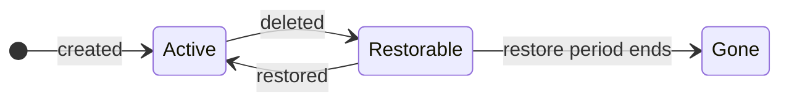

# Specification: Account Module (012)

This specification covers the package: `internal/account/modules/account/`.

## Overview

This module creates the tenant's Snowflake account and removes it when deletion is authorized, but it
does not configure the account. Together with the account, it creates a platform user: a technical user
that only the platform uses to control the account. Creation is complete only when the platform has
logged in as this user, not as soon as the account exists. Account parameters, network rules and
policies, authentication settings, users, roles and groups, and quotas are handled by later modules of
the pipeline, all of which connect through the platform user. On deletion, the module drops the account
and deletes the platform user's key, and both remain restorable for a configured period.

## Key Concept: The Platform User

Every account this module creates starts with a single user: the platform user. It is a technical user
that only the platform uses to control the account. Snowflake makes it the account's first
administrator. It has no password and logs in only with a key that the platform generates and keeps in
its secret store, so no person can log in as it. 

Snowflake has a similar user of its own, `SNOWFLAKE`, which it uses for support access.

All later modules configure the account through this user. Its key is therefore the one credential the
platform must not lose: without it, the platform has no way into the account and loses control over it.

## Key Concept: Account Names Are Unique Per Namespace

Snowflake requires account names to be unique across the whole organization, but tenants name their
accounts freely and cannot see other namespaces. Two teams both choosing `dev` is the normal case. Without
help, tenants would keep being rejected for names they could not have known were taken.

The platform therefore adds a short suffix derived from the tenant's namespace to the name they chose.
Accounts from different namespaces never collide, and tenants never have to think about it. Namespaces cannot be renamed, so the suffix never changes. 

```
name:       analytics-team-eu
namespace:  finance
            ↓
Snowflake:  analytics_team_eu_5k3wf
```

## Key Concept: Validation Checks

Before creating an account, the module checks two inputs that the CRD cannot check with structural
rules such as a regular expression.

The region is checked against the Backplane Config, a configuration file provided by Ops that lists the
regions the platform offers for new accounts.

Snowflake allows at most 63 characters for the account identifier
`<organization>-<account name>_<suffix>`. The organization name and the namespace suffix (see above) use
part of that, and the tenant's name gets what is left. The CRD does not know the organization name, so a name it accepted can
still be rejected here.

| Organization name | Longest account name |
|-------------------|----------------------|
| `a`               | 55 (the CRD's limit) |  
| `dataplatform`    | 44                   |

Both checks run only when the account is created, because region and name cannot change afterwards.

## Key Concept: Existence Is Recorded, Not Looked Up

The module does not ask Snowflake whether an account exists. Kubernetes is the source of truth: the
resource describes the intended account, and right after creation the module records the account's
Snowflake ID in the resource's status.

This has three benefits:

- **Cost:** no query to Snowflake on every reconcile, even for idle accounts.
- **Security:** no need for the organization-wide credential, which the platform uses only to create
  and drop accounts.
- **Safety:** once the ID is recorded, the account is never created again. If it later goes missing or
  cannot be reached, the module reports it instead of repairing it.

## Key Concept: A New Account Needs Time

A newly created account takes a few minutes before the platform can log in to it. Connecting too early
would only produce failures, in this module and in every module after it.

The module therefore waits for a period configured by Ops after creating the account, before it
connects for the first time. During this wait, no module connects to the account, and the resource
reports that the account is still being provisioned.

## Key Concept: Finishing an Interrupted Create

If the controller crashes while creating an account, the next run finds the key that the earlier
attempt already stored, and continues with it.

Picking up an existing key is safe. The key is stored in a place reserved for this resource, so a key
found there never belongs to another tenant.

A real problem must still not be hidden. The module therefore checks when the leftover key was written.
A key older than the resource cannot come from its own earlier attempt and points to a fundamental
problem, such as an earlier resource with the same name that was not cleaned up. The module reports it
as a system error instead of continuing, and an operator must resolve it manually.

```
    key written before:                     key written after:
    system error, operator resolves         own earlier attempt, continue
 ──────────────────────────────────────┼──────────────────────────────────────►  time
                               resource created
```

## Key Concept: Restorable Deletion

Deletion is not final right away. The module drops the account and deletes the platform user's key, but
both remain restorable for a period configured by Ops, so a mistaken deletion can be undone.
Until that period has passed, the account name cannot be reused in the same namespace.





## Public API

```go
// package account // internal/account/modules/account

// New constructs the account module (design.md 3.6). It implements
// internal/account/pipeline.Module's Observe/Apply/Teardown contract,
// identified by pipeline.AccountModuleName; see Key Concept:
// Existence Is Recorded, Not Looked Up, Key Concept: A New Account Needs Time,
// and SC-031-SC-033 (contact email sync) for what each method does.
//
// Parameters:
//   - keyManager: the *secrets.KeyManager (003) the platform keypair is stored through, via
//     KeyManager.CreateCredentials and, on teardown, KeyManager.DeleteCredentials — this module never calls
//     Update. On the fresh-create path, if CreateCredentials fails for any reason other than
//     ErrPendingDeletion, KeyManager.GetCredentials is called once, read-only, to decide whether a secret
//     found there is this resource's own crashed attempt (Key Concept: Finishing an Interrupted Create).
//   - org: Config.Snowflake.Org (002), used to build the tenant secret identifier (003) exactly as
//     internal/snowflake/pool does.
//   - gracePeriod: Config.Snowflake.AccountCreationGracePeriod (002) — how long a fresh account is
//     given to become reachable before the first post-create connection attempt.
//   - deletionGracePeriodDays: Config.Deletion.GracePeriodDays (002) — rendered verbatim as
//     DROP ACCOUNT's GRACE_PERIOD_IN_DAYS on teardown. Not to be confused with gracePeriod
//     above, which is a post-create reachability delay and has nothing to do with deletion.
//     Already bounded to 7-90 by 002's loader, so this module does not
//     re-validate it.
//   - usePrivateLink: Config.Snowflake.UsePrivateLink (002), used only to build status.accountUrl
//     (tenant.AccountURL).
//   - bpConfig: the loaded Backplane Config (007), consulted on the fresh-create path for region
//     existence via Region(), and — combined with the tenant's alpha-tester namespace label
//     (Key Concept: Validation Checks) — for region availability via Region.Available.
//
// Returns:
//   - pipeline.Module: never nil.
func New(keyManager *secrets.KeyManager, org string, gracePeriod time.Duration, deletionGracePeriodDays int, usePrivateLink bool, bpConfig *backplane.Config) pipeline.Module
```

`Observe`, `Apply` and `Teardown` themselves are unexported methods on the value `New` returns — nothing
outside this module's own tests calls them directly, so their behavior is documented under Key Concept:
Existence Is Recorded, Not Looked Up, Key Concept: A New Account Needs Time, and SC-031-SC-033 (contact
email sync) rather than here. All three read `status.accountLocator`/`status.accountCreatedAt` directly
through `ResourceData.CR()`, not through any `ResourceData` accessor — `internal/account/pipeline` (009)
defines none for either field.

`Teardown` runs three steps in a fixed order: `DROP ACCOUNT ... GRACE_PERIOD_IN_DAYS = <configured>` over
the org-admin connection, then `ResourceData.EvictTenant()` so no stale pooled connection to a dropped
account survives, then `KeyManager.DeleteCredentials` on the tenant secret identifier. Each step runs only once the one before
it succeeded, and a step whose object is already absent counts as success, so the whole sequence is safe to
re-run.

**Note**: every position of `CREATE ACCOUNT` was confirmed against live Snowflake to accept a bind (the
account name through `IDENTIFIER(?)`, every value through a plain `?`), so this module binds all of them
and renders nothing but its fixed keywords; see Security Considerations and 005's Verified Bind Positions.

## Project Structure

```text
internal/account/modules/account/
├── module.go            # module struct, New, Name()
├── observe.go           # Observe: existence probe via the tenant platform connection
├── apply.go             # Apply: keypair generation, credential storage, CREATE ACCOUNT, locator capture
├── teardown.go          # Teardown: DROP ACCOUNT, pool eviction, credential deletion
├── module_test.go
├── observe_test.go
├── apply_test.go
├── teardown_test.go
└── integration_test.go  # live Snowflake + AWS Secrets Manager create-then-destroy round trip
```

## Error Classification

**User Errors**:
- `spec.region` is not listed in the loaded Backplane Config (007) — surfaces as `Config.Region`'s own
  user error, passed through unchanged.
- `spec.region` exists but its `Region.Available` is `false` and the tenant's namespace is not labeled
  `alpha-tester: "true"` (Key Concept: Validation Checks) — this module's own message,
  wording matched to `Config.Region`'s unknown-region error so the two stay indistinguishable to the
  tenant.
- `cr.Name` combined with the real organization name would exceed Snowflake's 63-character DNS
  label limit once resolved (Key Concept: Validation Checks) — the message names only
  the max length, never the organization name or "DNS label", since the tenant can't act on
  either.
- `CREATE ACCOUNT` fails because the resolved account name is already taken by another account org-wide.
- The secret store's create-only write fails because the occupying secret is scheduled for deletion
  (`errors.Is(err, secrets.ErrPendingDeletion)`) — the account was deleted too recently.

**System Errors**:
- The namespace's `alpha-tester` label is present but not a valid boolean — surfaces as
  `tenant.AlphaTester`'s own system error, passed through unchanged.
- RSA keypair generation fails.
- The secret store's create-only write fails for any reason other than `ErrPendingDeletion`, and the
  occupying secret cannot be resumed as this resource's own crashed attempt (Key Concept: Finishing an
  Interrupted Create) — either because it cannot be read or parsed as valid credentials, or because it was
  written before `cr.CreationTimestamp` minus the clock-skew buffer.
- The resume path's pre-check for an already-existing account (`SHOW ACCOUNTS LIKE`) fails for any reason
  other than finding no match.
- The org-admin connection cannot be opened.
- `CREATE ACCOUNT` fails for any reason other than the name collision above.
- The post-create locator lookup finds no matching account despite `CREATE ACCOUNT` having just
  succeeded.
- The platform connection fails when a locator is already known (the account exists but is currently
  unreachable).
- `DROP ACCOUNT` fails for any reason other than the account already being absent.
- The credential's deletion fails for any reason other than the secret identifier already being absent.
- The platform user's `EMAIL` lookup (`SHOW USERS`) or update (`ALTER USER ... SET EMAIL`) fails for any
  reason (SC-033).

<br/><br/><br/><br/><br/>

================

## Appendix: Code Generation Details

## Scope

This specification defines the account module that:
- Confirms the resolved region exists in the Backplane Config (007) and, unless the tenant is an
  alpha tester, is available, before generating any credential or issuing any SQL.
- Generates and stores the `platform` service user's RSA keypair, create-only.
- Issues `CREATE ACCOUNT` over the org-admin connection and captures the returned account locator.
- Detects, on every reconcile, whether the account already exists — the pipeline's sole existence signal.
- Publishes the resolved account name and locator onto the shared `ResourceData` for every later module.
- Tears the account down: `DROP ACCOUNT` over the org-admin connection, eviction of the pooled
  connection to it, and deletion of the stored credential.
- Keeps the `platform` user's `EMAIL` in sync with `spec.contact` on every `Apply` against an existing
  account, via a live read-compare-then-write over the tenant connection (SC-031-SC-033).

**Out of Scope**:
- Authorizing a deletion (019), and the finalizer and conditions around one (020).
- `IdentitySyncRequest` emission (017).
- Drift detection or repair of the account's own parameters or the `platform` key — not until Snowflake
  ships Organization Policies (design.md Appendix B). This exclusion is about re-provisioning a rotated
  key, an organization-wide, disruptive action; it does not cover reasserting one free-text field
  (`EMAIL`) on a user this module already exclusively owns — see Scope above.

## Edge Cases

- **A crash lands between a successful credential store write (or `CREATE ACCOUNT`) and the locator
  being persisted to status — what happens on the next reconcile?** The next reconcile still has no
  locator, so it repeats the fresh-create path, and the credential store's create-only write fails because
  the identifier is already occupied from the previous attempt — but this is no longer where the trail ends
  (Key Concept: Finishing an Interrupted Create). The module reads the occupying secret's write time and compares
  it against this resource's own `creationTimestamp`: at or after it (minus a clock-skew buffer), the
  occupant can only be this resource's own earlier attempt, and the module resumes automatically — reusing
  the recovered credential verbatim, checking whether `CREATE ACCOUNT` already succeeded before
  (re-)issuing it, and proceeding exactly as a fresh create would from there. Manual recovery is now
  reserved for the two cases that genuinely cannot be resolved automatically: the occupying secret cannot
  be read or parsed as valid credentials at all, or it was written before this resource's own
  `creationTimestamp` — a leftover from something else (e.g. a previous same-named resource whose teardown
  did not fully clean up), which this module still cannot safely guess at. In either of those, an operator
  inspects the account directly in Snowflake and either patches the resource's status to point at the live
  account's locator, or deletes both the stray secret and any orphaned account so the resource can create
  cleanly on its next reconcile.
- **Why does `Apply` reconnect instead of failing outright whenever a locator is already known?** A
  locator being known does not by itself mean anything is wrong — it is also true of a perfectly healthy
  account whose `Apply` is running only because some other module further down the pipeline has drifted.
  Reconnecting distinguishes "healthy, nothing to do here" from "the account exists but the platform
  cannot reach it" — the second case, and only the second, is a real failure, and only that case is a failure
  (it aborts the pipeline like any other non-`Done` result of this module).
- **Why does the resource show repeated "Successfully requested creation" events during the post-create
  grace period?** While the grace period runs, `Observe` returns `Pending` even though a locator is known,
  so the pipeline (009) reports the account as not existing. Once crossplane-runtime's own default
  30-second creation grace period has passed, the managed reconciler therefore calls `Create` on every
  pass and records a `CreatedExternalResource` event each time. This is harmless: `Create` and `Update`
  run the same `Apply` (020), and `Apply` checks the locator first and never issues `CREATE ACCOUNT`
  again. Only the events are misleading.
- **Why does the post-create locator lookup discard rows that aren't an exact, case-insensitive match?**
  A pattern-matching lookup treats every underscore in the resolved account name as a single-character
  wildcard, since the resolved name always contains underscores by construction. Left unguarded, this
  lookup could return a different account's row whenever that account's name happens to match at every
  other position. The comparison is also case-insensitive because the resolved name is generated in
  lowercase, while Snowflake displays unquoted identifiers uppercased.
- **Why does `Observe` never look accounts up over the org-admin connection?** The org-admin connection
  is reserved for `CREATE ACCOUNT` and `DROP ACCOUNT` alone. Every module downstream of this one already
  needs a connection authenticated as the account's own `platform` user, so `Observe` reuses that same
  path to check existence rather than opening a more privileged one just to look.
- **Does this module need anything from the Backplane Config (007)?** Yes, two calls, both on the
  fresh-create path and both before any side effect (keypair generation, secret storage, or the
  org-admin connection): `Region(cr.Spec.Region)`, to confirm the region exists in the loaded config,
  and a check of the returned `Region.Available`, bypassed only for alpha-tester namespaces (Key
  Concept: Validation Checks). The region value `CREATE ACCOUNT` binds still comes
  entirely from the CRD plus a fixed transform; the Backplane Config only gates whether that literal
  is attempted at all.
- **Why does this module re-check an account-name length the CRD (006) already bounds?** The
  CRD's ceiling assumes the shortest possible organization name, because `metadata.name` is
  validated with no knowledge of this deployment's actual `org` value. A real organization name
  is almost always longer than one character, so a name the CRD accepts can still make
  `<org>-<resolvedName>` exceed Snowflake's 63-character DNS label limit. This module is the
  first point in the pipeline that holds both values together, so it is where the exact bound
  can finally be checked — and, like the region check above, before any side effect. The
  rejection message collapses the check back into a single max-length number rather than
  exposing `org` or the DNS-label arithmetic, since neither is something the tenant can act on.
- **Why look the email up before writing it, when this module doesn't bother for anything else it
  owns?** Unlike the RSA key or the account's own existence, `EMAIL` is compared on every single `Apply`
  call for an existing account — not just when `spec.contact` itself changed, since the pipeline calls
  every module's `Apply` unconditionally whenever the CRD's generation has moved, for any reason. Skipping
  the read and reasserting unconditionally would put a same-value `ALTER USER` in Snowflake's query
  history on nearly every reconcile of a perfectly healthy tenant; the read avoids that at the cost of one
  extra query, and still requires no new state to be kept on `status`.
- **What does a namespace's malformed `alpha-tester` label do to a fresh create?** Fails (aborting) with the
  system error `tenant.AlphaTester` itself returns (006) — an ops-caused label problem, like a malformed
  `credit-quota` label — before the region-existence check's result is even used to decide anything,
  and before any side effect.
- **A deletion arrives when no locator was ever recorded — what does `Teardown` do?** With no locator
  there is no account to drop and no pooled connection to evict, so both steps are skipped and only the
  credential is deleted. That clears the stray secret a crashed create leaves behind (see above); if an
  account really was created and its locator never persisted, dropping it stays the manual operator job
  that case already describes.
- **The credential identifier is scheduled for deletion but not yet gone — what does the next reconcile see?**
  Neither present nor absent. An identifier inside its recovery window cannot be read and cannot be re-created
  (003), so `Observe` cannot treat it as a live credential and `Apply`'s fresh-create path cannot claim it
  either. `Apply` recognizes this case (`secrets.ErrPendingDeletion`) and rejects with a message naming
  the account and its deletion recovery window — never the secret identifier. The state is still self-clearing,
  bounded by the account's own grace period; there is nothing more for this module to do than report it
  clearly.
- **Why render the configured grace period rather than Snowflake's minimum of 3?** Because 3 is the value
  that makes recovery least likely to work: it is below the 7-day floor AWS Secrets Manager can represent,
  so the credential would be destroyed outright on every deletion and every restore would need the manual
  repair above. The configured default of 30 is instead the largest value the reference store matches
  exactly.
- **The account, or the secret identifier, is already gone — does `Teardown` fail?** No. Both count as
  success, so a destruction retried after a partial failure — or after an operator cleaned up by
  hand — converges instead of stalling. For the credential this is `KeyStore.Delete`'s own idempotency
  (003), so this module never pre-checks presence and never swallows a credential-deletion error: an
  unreachable store must not pass for an absent credential.

## Dependencies

- **Base Configuration (002)** — Used APIs: `Config.Snowflake.Org`, `Config.Snowflake.AccountCreationGracePeriod`,
  `Config.Deletion.GracePeriodDays` — Contract: all three passed to `New` as plain values; this module never
  loads the config file itself, and never re-validates `GracePeriodDays`, which 002's loader has already
  bounded to 7-90.
- **Backplane Config (007)** — Used APIs: `Config.Region()`, `Region.Available` — Contract: `bpConfig`
  passed to `New`; the fresh-create path calls `Region(cr.Spec.Region)` once, before any side effect,
  and passes any returned error straight into `Failed` unmodified — the error is already
  tenant-appropriate and user-classified by 007 itself, so this module authors no message of its own
  for that case. It then reads the returned `Region.Available` itself and, combined with
  `tenant.AlphaTester`, authors its own user error when the region is unavailable and the tenant is
  not an alpha tester (Key Concept: Validation Checks), reusing 007's own unknown-region
  wording so the two cases stay indistinguishable to the tenant.
- **Secrets Handling (003)** — Used APIs: `NewTenantIdentifier()`, `KeyManager.CreateCredentials()`,
  `KeyManager.GetCredentials()`, `KeyManager.DeleteCredentials()`, `ErrPendingDeletion` — Contract:
  `CreateCredentials` and `DeleteCredentials` for normal operation, never `Update`. On the fresh-create
  path, if `CreateCredentials` fails for a reason other than `ErrPendingDeletion`, the module calls
  `GetCredentials` once to read the occupying secret's `RotatedAt` and decide whether to resume (Key
  Concept: Finishing an Interrupted Create) — the only case this module ever reads a stored credential back, and
  it still never writes to what it finds there. `DeleteCredentials`'s recovery window is
  the key store's own business — this module passes no window and cannot choose one. Matches
  `CreateCredentials`'s error against `ErrPendingDeletion` via `errors.Is` and decides its own classification and message for
  that case.
- **Connection Pooling (004)** — Used APIs: `ResourceData.OrgAdminDB()`, `ResourceData.TenantDB()`,
  `ResourceData.EvictTenant()` — Contract: reached only through `ResourceData`; this module never
  imports `internal/snowflake/pool` or `internal/snowflake/host` directly.
- **Statement Execution (005)** — Used APIs: `statement.New()`, `Runner.Exec()`, `Runner.Query()`,
  `*statement.Error` — Contract: every tenant-influenced value is passed as a bind argument, never
  concatenated into statement text; none of 005's rendering primitives is used.
- **SnowflakeAccount CRD (006)** — Used APIs: `SnowflakeAccountSpec.Description`, `.Contact`, `.Region`,
  `SnowflakeAccountStatus.AccountLocator`, `.AccountCreatedAt`, `internal/account/tenant.AlphaTester()`
  — Contract: reads the spec fields read-only; writes `AccountLocator`/`AccountCreatedAt` directly on
  `ResourceData.CR().Status`, plus `AccountName`/`AccountURL` (Integration Points). Calls
  `tenant.AlphaTester()` once on the fresh-create path against `ResourceData.NamespaceLabels()`,
  before any side effect, and passes its returned error (a malformed label value, a system error) straight into
  `Failed` unmodified.
- **Account Pipeline (009)** — Used APIs: `account.Module`, `Done()`/`Pending()`/`Failed()`,
  `ResourceData.CR()`, `.Logger()`, `.ResolvedAccountName()`, `.OrgAdminDB()`, `.TenantDB()`,
  `.EvictTenant()` — Contract: `Name()` returns `pipeline.AccountModuleName`, which is how
  `Pipeline.Observe` finds the outcome that decides existence regardless of registration position; calls `.Abort()` on every
  outcome that is not `Done`; a tenant mistake is `Failed(errors.NewUserError(...))`; `Teardown` returns a plain classified error, not an `Outcome`, and
  is reached only through `Pipeline.Destroy`.

## Integration Points

- **SnowflakeAccount Controller (020)** — Registers this module in the pipeline via
  `account.New(keyManager, baseConfig.Snowflake.Org, baseConfig.Snowflake.AccountCreationGracePeriod,
  baseConfig.Deletion.GracePeriodDays, baseConfig.Snowflake.UsePrivateLink, bpConfig))`,
  after the guardrail-check (010) and quota-check (011) modules. This module itself writes all four
  account status fields on the CRD: `status.accountLocator` and `status.accountCreatedAt` on create,
  and `status.accountName` (from `ResourceData.ResolvedAccountName()`) and `status.accountUrl` (via
  `internal/account/tenant.AccountURL`, using `usePrivateLink`) on every `Observe` once a locator is known and
  on every `Apply`. A `tenant.AccountURL` error is logged through `ResourceData.Logger()` and never fails the
  run; the URL then simply stays unset. None of the four needs a separate persist step: this module writes
  them straight onto the same `*v1alpha1.SnowflakeAccount` the controller already holds and will persist
  when the reconcile returns. Minimizing how long that persist is deferred is still 020's responsibility,
  since every reconcile between a successful `CREATE ACCOUNT` and the actual API-server write is the
  crash window described above. Reaches the drop only through `Pipeline.Destroy`, once an active deletion
  request (019) has authorized it — never by calling this module directly.

## Success Criteria

- **SC-001**: `Observe` returns `Pending("account not created yet")` with no connection attempt when no locator is known.
- **SC-002**: `Observe` returns `Done` once a known locator's platform connection succeeds.
- **SC-003**: `Observe` returns `Failed`, with a system error, when a known locator's platform
  connection fails.
- **SC-004**: `Apply` returns `Done()` without touching the credential store or issuing `CREATE ACCOUNT`
  when a locator is already known, the grace period (if any) has elapsed, and the platform connection
  succeeds.
- **SC-005**: `Apply` aborts with a system error, and issues no SQL, when a locator is already known, the
  grace period (if any) has elapsed, but the platform connection fails.
- **SC-006**: When the resolved secret identifier was not previously occupied, a fresh create generates a
  keypair, stores it create-only, then issues `CREATE ACCOUNT` — in that order, and only in that order,
  with no existence pre-check in between.
- **SC-007**: A fresh create aborts with a system error, issuing no SQL, when the resolved secret
  identifier is occupied by a secret that is not this resource's own crashed attempt — because it cannot
  be read or parsed as valid credentials, or because it was written before `cr.CreationTimestamp` minus the
  clock-skew buffer (Key Concept: Finishing an Interrupted Create; see SC-035-SC-037 for the resumable
  case).
- **SC-007a**: A fresh create aborts with a user error naming the account and its deletion recovery
  window — never the secret identifier — when the resolved secret identifier is occupied by a secret scheduled for
  deletion.
- **SC-035**: When the resolved secret identifier is occupied by a secret written at or after
  `cr.CreationTimestamp` (minus the clock-skew buffer), and no account yet exists under the resolved name,
  a fresh create resumes: it reuses the occupying credential's public key verbatim (no new keypair is
  generated) and issues `CREATE ACCOUNT` with it.
- **SC-036**: Under the same resumable condition as SC-035, when an account already exists under the
  resolved name, a fresh create skips `CREATE ACCOUNT` entirely and persists the found locator directly.
- **SC-037**: The resume path's existence pre-check (SHOW ACCOUNTS LIKE) failing for any reason other than
  finding no match aborts with a system error, and `CREATE ACCOUNT` is never issued.
- **SC-008**: `CREATE ACCOUNT`'s `REGION` literal is the CRD's region uppercased with every `-` replaced
  by `_`.
- **SC-009**: `CREATE ACCOUNT`'s `COMMENT` clause is omitted entirely when `spec.description` is empty.
- **SC-010**: `CREATE ACCOUNT`'s `EMAIL` is always `spec.contact`.
- **SC-011**: a missing or non-email-shaped `spec.contact` is rejected by the API server at admission
  (006), before this module ever runs.
- **SC-012**: A `CREATE ACCOUNT` failure due to an org-wide name collision is classified as a user error;
  every other `CREATE ACCOUNT` failure is classified as a system error.
- **SC-013**: The post-create locator lookup discards a row whose account name is not an exact,
  case-insensitive match to the resolved name, even when the lookup's own pattern matching returns it.
- **SC-014**: A fresh create aborts with a system error when the post-create locator lookup finds no
  matching row.
- **SC-015**: A successful fresh create sets `cr.Status.AccountLocator` to the looked-up locator and
  `cr.Status.AccountCreatedAt` to the current time, directly on the CRD, before returning
  `Pending(...)` — never `Done()`.
- **SC-016**: Every `Apply` outcome other than `Done()` carries `Aborted == true`; `Done()` does not.
- **SC-017**: Unit test coverage exceeds 95%.
- **SC-018**: Integration test coverage includes a full create-then-reconnect-then-destroy round trip
  against a live Snowflake organization and a live secrets backend.
- **SC-019**: Both `Observe` and `Apply`'s reconnect path attempt no platform connection, and issue no
  error, while `time.Since(cr.Status.AccountCreatedAt) < gracePeriod`; `Apply` and `Observe` report
  `Pending(...)` with no error.
- **SC-020**: `cr.Status.AccountCreatedAt` is set exactly once, on the reconcile that first creates the
  account, and is never touched again on any later reconcile — including one that lands inside the grace
  period.
- **SC-021**: A `nil` `cr.Status.AccountCreatedAt` with a known locator is treated as past the grace
  period: `Observe`/`Apply` attempt a connection exactly as they did before this field existed.
- **SC-022**: `Teardown` binds the resolved account name via `IDENTIFIER(?)` and always includes a
  `GRACE_PERIOD_IN_DAYS` clause carrying the value `New` was given, unchanged and unclamped.
- **SC-023**: `Teardown` issues no SQL and evicts nothing when `cr.Status.AccountLocator` is empty, and
  still deletes the credential.
- **SC-024**: `Teardown` returns nil when the account is already absent, and when the secret identifier is
  already absent.
- **SC-025**: `Teardown` drops the account, then evicts the pooled connection, then deletes the
  credential — in that order, and performs no later step once one has failed.
- **SC-026**: `Teardown` passes `Config.Deletion.GracePeriodDays` straight into the rendered
  `GRACE_PERIOD_IN_DAYS` for every value 002 admits (7 and 90 at the bounds), and derives no window of its
  own for the credential.
- **SC-027**: A fresh create calls `Config.Region(cr.Spec.Region)` before generating a keypair,
  storing any secret, or opening the org-admin connection; when `Region()` returns an error, `Apply`
  aborts with that error unchanged (`Failed(err)`, a user error) and performs none of those three
  side effects.
- **SC-028**: A fresh create aborts with a user error, generating no keypair and issuing no SQL, when
  the resolved region exists, `Region.Available` is `false`, and the tenant's namespace is not labeled
  `alpha-tester: "true"`.
- **SC-029**: A fresh create proceeds past the availability check — reaching keypair generation exactly
  as an available region would — when `Region.Available` is `false` but the tenant's namespace is
  labeled `alpha-tester: "true"`.
- **SC-030**: A fresh create aborts (`Failed`) with `tenant.AlphaTester`'s own system error, generating no keypair
  and issuing no SQL, when the namespace's `alpha-tester` label is present but not a valid boolean.
- **SC-031**: On the existing-account reconnect path, `Apply` issues `SHOW USERS LIKE 'platform'` over
  the tenant connection and issues no `ALTER USER` when the looked-up `email` already equals
  `spec.contact`.
- **SC-032**: On the existing-account reconnect path, `Apply` issues `ALTER USER "platform" SET EMAIL =
  spec.contact`, over the tenant connection and never the org-admin connection, whenever the looked-up
  email differs from `spec.contact` or no row names the `platform` user at all.
- **SC-033**: A `SHOW USERS` or `ALTER USER` failure during the email sync is classified as a system
  error and aborts `Apply` (`Failed(...)`).
- **SC-034**: A fresh create aborts with a user error, generating no keypair and issuing no SQL,
  when `cr.Name` is longer than `63 - 1 - 6 - len(org)` characters; it proceeds normally at
  exactly that length. The error message states only the numeric max length — never `org` or
  "DNS label".

## Security Considerations

- The org-admin connection is opened only inside this module, and only on the fresh-create and teardown
  paths — no other module, and no other path through this one, ever requests it.
- This module does not check whether a destruction is authorized: it drops whenever `Teardown` is called.
  The deletion permit's two-key gate (019) is what stands between a tenant's `kubectl delete` and that
  call.
- The secret store's create-only write is the sole safeguard against overwriting a live account's
  credential on a retried request. The module does read a stored credential back exactly once — only after
  that create-only write has already failed, and only to compare `RotatedAt` against this resource's own
  `creationTimestamp` to decide whether the occupant is this resource's own crashed attempt (Key Concept:
  Finishing an Interrupted Create). What the create-only write still guarantees is that a found credential is
  only ever reused verbatim, never regenerated or overwritten — this module calls `KeyManager.Update`
  nowhere, resume included.
- The post-create locator lookup's pattern matching is a coarse pre-filter only; the exact,
  case-insensitive re-check is load-bearing, not defensive style, given how often the resolved account
  name's own underscores would otherwise produce a false match.
- **`CREATE ACCOUNT` binding.** Every position that carries a value binds, so no tenant-supplied text —
  `EMAIL` and `COMMENT` are the free-text ones — is ever part of the statement text and none needs
  escaping. Only the fixed keywords (`ADMIN_USER_TYPE=SERVICE`, `EDITION=ENTERPRISE`) are literal text. The
  region value is the one transformed into Snowflake's region-identifier form before binding.
  Priority is injection safety over fidelity: Snowflake interprets backslash escapes and doubled single
  quotes inside a bound string, so a `spec.description` containing `\` or `''` is stored altered (005,
  Verified Bind Positions). That is accepted.

  | Position | Value | Form |
  | --- | --- | --- |
  | account name | the resolved account name (design.md 3.12) | `IDENTIFIER(?)` |
  | `ADMIN_NAME` | fixed `"platform"` | `?` |
  | `ADMIN_RSA_PUBLIC_KEY` | the generated public key | `?` |
  | `ADMIN_USER_TYPE` | fixed `SERVICE` | keyword |
  | `EMAIL` | `spec.contact` (email-shape checked at admission, 006) | `?` |
  | `EDITION` | fixed `ENTERPRISE` | keyword |
  | `REGION` | `spec.region`, transformed into Snowflake's region-identifier form | `?` |
  | `COMMENT` | `spec.description` (tenant free text); clause omitted if empty | `?` |

- **`DROP ACCOUNT` binding.** The resolved account name binds through `IDENTIFIER(?)`. `GRACE_PERIOD_IN_DAYS`
  does not bind (the statement fails with a syntax error, 005's Verified Bind Positions), so the `int`
  from ops-owned provider configuration (002), already bounded to 7-90 by 002's loader, is formatted into
  the text. No tenant-supplied text reaches this statement at all, and no tenant can influence the grace
  period — deletion protection would be worthless if the party being protected from could shorten the
  window it is protected by.

- **`SHOW USERS`/`ALTER USER` binding (contact email sync, SC-031-SC-033).** The fixed literal
  `"platform"` — both as the `SHOW USERS LIKE` pattern and as the `ALTER USER` target — and
  `spec.contact` are all bind arguments.

  | Position | Value | Form |
  | --- | --- | --- |
  | `SHOW USERS LIKE` pattern | fixed `"platform"` | `?` |
  | `ALTER USER` target | fixed `"platform"` | `IDENTIFIER(?)` |
  | `EMAIL` | `spec.contact` (email-shape checked at admission, 006) | `?` |

## References

- **Product design**: `specs/design.md` §3.2, §3.6, §3.11, §3.11.1, §3.12, §6.1–§6.3 (the deletion
  flow this module's teardown is the last phase of), Appendix B (X1).
- **Account Pipeline**: `internal/account/pipeline/module.go`, `resourcedata.go`, `pipeline.go` — the `Module`
  interface, `Outcome` vocabulary, and shared `ResourceData` this module implements against.
- **Secrets Handling**: `internal/secrets/keystore.go`, `manager.go`, `identifier.go`, `credentials.go`.
- **Statement Execution**: `internal/snowflake/statement/statement.go`, `render.go`, `errors.go`.
- **Snowflake `CREATE ACCOUNT` reference**: https://docs.snowflake.com/en/sql-reference/sql/create-account
  — required parameters, and which parameter positions are quoted string literals versus bare tokens.
- **Snowflake `SHOW ACCOUNTS` reference**: https://docs.snowflake.com/en/sql-reference/sql/show-accounts
  — the `account_locator`/`account_name` columns, and `LIKE`'s wildcard-only, case-insensitive matching.
- **Snowflake `DROP ACCOUNT` reference**: https://docs.snowflake.com/en/sql-reference/sql/drop-account
  — `GRACE_PERIOD_IN_DAYS` being required, its range of 3-90, and the account staying restorable (and its
  name taken) for that period.
- **Snowflake `SHOW USERS` reference**: https://docs.snowflake.com/en/sql-reference/sql/show-users —
  the `name`/`email` columns, and `LIKE`'s wildcard-only, case-insensitive matching (SC-031).
- **Snowflake `ALTER USER` reference**: https://docs.snowflake.com/en/sql-reference/sql/alter-user —
  the `SET EMAIL = '<string>'` property.
- **Base Configuration**: `specs/002-base-config.md` — `deletion.gracePeriodDays`, the single setting both
  windows derive from.
- **Secrets Handling**: `specs/003-secrets-handling.md` — Key Concept: Deleting a Credential Reserves Its
  Identifier. The concrete window computation lives in `specs/003.a-aws-secrets-backend.md`.
- **Backplane Config**: `specs/007-backplane-config.md` — `Config.Region()`, `Region.Available`, and
  its Error Classification's tenant-facing "not yet available" wording, reused for the availability
  check.
- **SnowflakeAccount CRD**: `specs/006-snowflake-account-crd.md` — `internal/account/tenant.AlphaTester()`.

<br/><br/><br/><br/><br/>

================

## Appendix: Usage Examples

### Example 1: Wiring the module into the pipeline (020)

```go
import (
    accountmodule "github.com/allianz/yukimi/internal/account/modules/account"
    "github.com/allianz/yukimi/internal/account/pipeline"
)

pl := pipeline.New(
    guardrailcheckmodule.New(...),                                // 010, runs first, aborts before anything else
    quotacheckmodule.New(...),                                    // 011, runs second, aborts before CREATE ACCOUNT
    // 012 — the two grace periods are unrelated: the duration is a post-create
    // reachability delay, the int is DROP ACCOUNT's GRACE_PERIOD_IN_DAYS.
    accountmodule.New(
        keyManager,
        baseConfig.Snowflake.Org,
        baseConfig.Snowflake.AccountCreationGracePeriod,
        baseConfig.Deletion.GracePeriodDays,
        baseConfig.Snowflake.UsePrivateLink,
        bpConfig,
    ),
    // ... modules 013-015, 017, 018, in order
)
```

### Example 2: Create, wait out the grace period, then reconnect

```go
data := pipeline.NewResourceData(cr, nsLabels, log, pool)

// First reconcile: no locator yet.
o := module.Observe(ctx, data)           // Pending("account not created yet"), nothing has been touched yet
outcome := module.Apply(ctx, data)       // generates keypair, stores it, issues CREATE ACCOUNT,
                                        // sets cr.Status.AccountLocator/.AccountCreatedAt directly,
                                        // returns Pending(...).Abort() — the pipeline stops here

// A reconcile landing inside the grace period, against the same cr (status.accountLocator and
// status.accountCreatedAt already set by the pass above):
data2 := pipeline.NewResourceData(cr, nsLabels, log, pool)
outcome2 := module.Observe(ctx, data2) // StatePending — no connection attempted
_ = module.Apply(ctx, data2)                    // same skip; Pending(...).Abort(), no connection attempted

// A later reconcile, once the grace period has elapsed:
data3 := pipeline.NewResourceData(cr, nsLabels, log, pool)
o3 := module.Observe(ctx, data3) // reconnects as platform; Done
outcome3 := module.Apply(ctx, data3)     // reconnects again; SHOW USERS LIKE 'platform' finds the email
                                        // already matches spec.Contact, so no ALTER USER is issued;
                                        // returns Done()

// Deletion, reached through Pipeline.Destroy once a deletion permit (019) has authorized it:
err := module.Teardown(ctx, data3)       // DROP ACCOUNT ... GRACE_PERIOD_IN_DAYS = 30, evicts the
                                        // pooled connection, deletes the stored credential — which
                                        // the store keeps restorable for 30 days too, never longer
```
