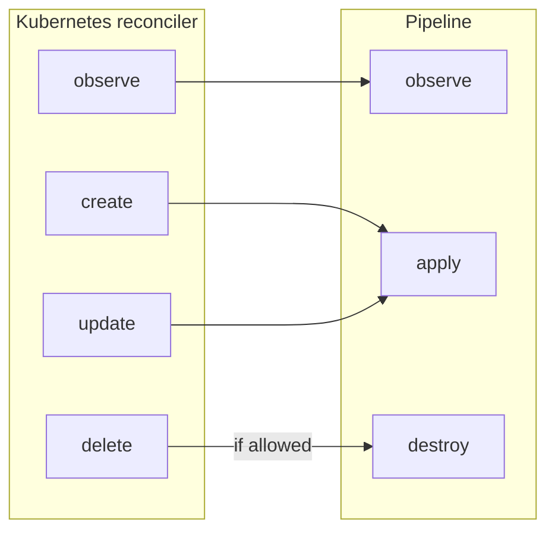

# Specification: SnowflakeAccount Controller (020)

This specification also finishes `cmd/provider/main.go`'s bootstrap wiring (config, key store,
connection pool) and updates `internal/controller/yukimi.go`'s registration list — neither file is owned
by a numbered spec of its own (design.md §1.2), and this is the first controller that needs any of it.

## Overview

The SnowflakeAccount controller is the component Kubernetes calls whenever a tenant's
SnowflakeAccount resource is created, changed, deleted, or due for its periodic check. It connects
two parts of the platform. One is Kubernetes, where tenants describe the accounts they want as
resources and read back their state. The other is the account pipeline (009), which does the work in
Snowflake.

The controller contains little logic of its own. The pipeline and its modules determine what happens
to an account: what is created, checked, configured and torn down. The controller passes each request
to the pipeline and writes the result back onto the resource. The only decision it makes itself is
whether an account may be deleted. The pipeline (009) and its modules specify how an account behaves.
This spec covers how that behavior is connected to Kubernetes.


## Key Concept: A Thin Layer Between Kubernetes and the Pipeline

Kubernetes reconciles a resource in two steps. It first observes the resource and then, depending
on the result, creates, updates or deletes the external state the resource describes (009, The
Reconcile Loop). The pipeline provides three
operations: observe, apply and destroy. The controller maps each reconciler request onto one of these
operations, then converts the pipeline's result back into Kubernetes terms. 



The reconciler's observe is forwarded to the pipeline's observe. Create and update are both handled
by only a single apply function. Apply works declaratively from the spec, so a new account and an existing one are handled the same way. Delete is forwarded to destroy only after the deletion gate has authorized 
it (Key Concept: Enforcing the Deletion Permit).

The controller is stateless. Each request reads the resource and its namespace's labels at the time
of the request and passes both to the pipeline. Any information that must persist between requests
is stored on the resource itself.

The controller is intentionally kept thin. All logic that can be tested without Kubernetes lives in
the pipeline and its modules.


## Key Concept: What Observe Reports to Kubernetes

Observe runs on every pass, including each periodic check, and changes nothing in Snowflake. It has
two purposes. It answers the reconciler's questions, which decide whether apply runs next. It also
refreshes what the resource shows, so the resource reflects the account's current state even when
nothing needs to change.

Every value comes from the pipeline's observe (009, From Module Outcomes to Controller State), and the
controller passes it to Kubernetes unchanged.

| Value             | Meaning                                                                                                        | Effect in Kubernetes                                                                                   |
|-------------------|----------------------------------------------------------------------------------------------------------------|--------------------------------------------------------------------------------------------------------|
| Exists            | The account has been created. Only the account module decides this.                                           | If false, the reconciler calls create.                                                                 |
| Up to date        | The last apply completed for the current spec, and nothing has drifted since.                                   | If false, the reconciler calls update.                                                                 |
| Error             | The first module failure: a message the tenant can act on, or an incident reference for a platform fault (001). | Synced is set to false with that message. Neither create nor update is called, and the pass is retried later. |
| Ready             | Whether the account has ever been fully provisioned. Once true, it stays true. Until then, it carries the first reason for waiting. | Set on the resource. Tools watching the resource use it to report health.                               |
| Module conditions | Conditions that individual modules own, such as credits used up or groups still syncing.                       | Set on the resource alongside Ready and Synced.                                                        |
| Events            | Notable occurrences that modules report, such as a warning when credits run out.                               | Recorded on the resource.                                                                              |

An error ends the pass before anything is changed. The reconciler never creates or updates an
account based on an incomplete observation.


## Key Concept: What Apply Reports to Kubernetes

Create and update run only when observe reports that the account is missing or not up to date. Both
run apply, which changes the account to match its spec. Apply does not answer the reconciler's
questions itself. The next observe does that, based on what this apply recorded. Instead, apply
reports what happened during the pass.

Every value comes from the pipeline's apply (009, From Module Outcomes to Controller State), and the
controller passes it to Kubernetes unchanged.

| Value                | Meaning                                                                                                        | Effect in Kubernetes                                                                                   |
|----------------------|----------------------------------------------------------------------------------------------------------------|--------------------------------------------------------------------------------------------------------|
| Error                | The first module failure: a message the tenant can act on, or an incident reference for a platform fault (001). | Synced is set to false with that message, and the pass is retried later. Without an error, Synced is set to true. |
| Ready                | Turns true the first time an apply completes with every module done, and then stays true. Until then, it carries the first reason for waiting. | Set on the resource. After a create, Kubernetes shows the resource as creating until the next observe. |
| Module conditions    | Conditions that individual modules own, such as credits used up or groups still syncing.                       | Set on the resource alongside Ready and Synced.                                                        |
| Events               | Notable occurrences that modules report, such as a warning when credits run out.                               | Recorded on the resource.                                                                              |
| Applied spec version | Recorded only when every module completed for the current spec.                                                | Lets the next observe report the account as up to date.                                                |
| Account details      | The account's Snowflake name, login URL and identifier, written by the account module.                         | Saved on the resource immediately, so they are kept even when the pass fails. Without the identifier, the next pass would create the account again. |

A failed apply is always returned to Kubernetes as an error. Otherwise Kubernetes would record the
pass as successful and hide the failure.


## Key Concept: The Resource Is the Tenant's Only Feedback

Tenants never see the controller's logs, so everything they need to know has to appear on the
SnowflakeAccount resource. That covers whether the account is ready, whether the last pass ran into
a problem, what individual modules report (credits used up, groups still syncing), events, and the
account's Snowflake name and login URL. Whatever tool a tenant uses to deploy and watch their
resources reads the same conditions to show the account as healthy or failing.

The controller writes this picture after every pass, observe and apply alike. The picture therefore
always reflects the latest pass, not the last pass that happened to change something. The pipeline
decides what the picture contains, and the controller copies it onto the resource unchanged.

The summary view shows one account that is provisioned, one still being created, and one that failed:

```console
$ kubectl get snowflakeaccounts -n finance
NAME                READY   SYNCED   REASON      ACCOUNT-URL                                                                     AGE
analytics-team-eu   True    True     Available   https://xy12345.eu-central-1.privatelink.snowflakecomputing.com/console/login   12d
reporting-dev       False   True     Creating    https://ab67890.eu-central-1.privatelink.snowflakecomputing.com/console/login   4m
sandbox             False   False    Creating                                                                                    1m
```

The detailed view shows an account that has used up its monthly credits but is still Ready:

```console
$ kubectl describe snowflakeaccount analytics-team-eu -n finance
Name:         analytics-team-eu
Namespace:    finance
API Version:  base.snowflake.yukimi.io/v1alpha1
Kind:         SnowflakeAccount
Spec:
  ...
Status:
  Account Created At:  2026-10-11T08:14:02Z
  Account Locator:     xy12345
  Account Name:        analytics_team_eu_5k3wf
  Account URL:         https://xy12345.eu-central-1.privatelink.snowflakecomputing.com/console/login
  Conditions:
    Last Transition Time:  2026-10-11T08:31:47Z
    Reason:                Available
    Status:                True
    Type:                  Ready
    Last Transition Time:  2026-10-23T09:02:15Z
    Reason:                ReconcileSuccess
    Status:                True
    Type:                  Synced
    Last Transition Time:  2026-10-23T09:02:15Z
    Message:               Monthly credit quota of 500 used up; warehouses are suspended until the next billing cycle
    Reason:                QuotaExhausted
    Status:                False
    Type:                  QuotaAvailable
  Observed Generation:     3
Events:
  Type     Reason          Age   From                                                Message
  ----     ------          ----  ----                                                -------
  Warning  QuotaExhausted  12m   managed/snowflakeaccount.base.snowflake.yukimi.io  Monthly credit quota of 500 used up; warehouses are suspended until the next billing cycle
```


## Key Concept: Enforcing the Deletion Permit

This controller enforces the deletion permit defined in 019. Without an active permit, a deleted
resource stays in Terminating, with a warning event and Ready set to false. The permit is marked as
used only after the teardown succeeds, so a failed teardown can be retried. A resource whose account
was never created, for example because its name failed validation, is removed without a permit.


## Public API

```go
package snowflakeaccount // internal/controller/snowflakeaccount

// SetupGated adds a controller that reconciles SnowflakeAccount objects with
// safe-start support, wired into internal/controller/yukimi.go alongside
// every other resource's controller (design.md §3.2, §6.3, §7).
//
// Registers a pipeline (009) of exactly one module for this cut (see
// Scope):
//
//	pipeline.New(accountmodule.New(
//	    keyManager,
//	    cfg.Snowflake.Org,
//	    cfg.Snowflake.AccountCreationGracePeriod,
//	    cfg.Deletion.GracePeriodDays,
//	    cfg.Snowflake.UsePrivateLink,
//	    bpConfig,
//	))
//
// Parameters:
//   - cfg: the provider's base configuration (002) — read for
//     Snowflake.Org, Snowflake.AccountCreationGracePeriod,
//     Snowflake.UsePrivateLink (status.accountUrl),
//     Deletion.GracePeriodDays, and Deletion.Protection (the deletion
//     gate's on/off switch, read directly by Delete).
//   - p: the pooled Snowflake connections (004), satisfying
//     pipeline.DBPool; shared with every other controller that ever needs
//     one.
//   - keyManager: the *secrets.KeyManager (003), passed straight
//     into the account module's own constructor (012) — this controller
//     never calls it directly.
//   - bpConfig: the loaded Backplane Config (007), passed straight into
//     the account module's own constructor (012) — this controller never
//     calls Region()/Connection() itself.
//
// Returns:
//   - error if registration with the manager fails; never an error from
//     anything Snowflake- or secrets-related, since SetupGated performs
//     no I/O of its own.
func SetupGated(mgr ctrl.Manager, o controller.Options, cfg *base.Config, p *pool.Pool, keyManager *secrets.KeyManager, bpConfig *backplane.Config) error
```

## Project Structure

### Source Code

```text
internal/controller/snowflakeaccount/
├── doc.go
├── reconciler.go        # SetupGated/Setup, connector, external — Observe/Create/Update/Delete,
│                         # the deletion gate, and the small namespace-label lookup helper
├── reconciler_test.go
└── integration_test.go  # TestIntegration...: full create-then-destroy round trip against a live
                          # Snowflake org, a live AWS Secrets Manager, and a real Kubernetes API (kind)
```

Modified, pre-existing files (owned by no numbered spec — design.md §1.2):

```text
cmd/provider/main.go            # --configDir flag; base.Load (002); backplane.Load (007); a
                                 # cloud-provider switch constructing the AWS key store (003.a);
                                 # secrets.NewKeyManager (003); pool.New (004); pool.Close() on
                                 # shutdown; forwards Config, the pool, the key manager, and the
                                 # loaded *backplane.Config into internal/controller/yukimi.SetupGated
internal/controller/yukimi.go   # SetupGated gains cfg/pool/keyManager/bpConfig parameters and
                                 # forwards them into snowflakeaccount.SetupGated, alongside the
                                 # unchanged call to deletionpermit.SetupGated
```

## Error Classification

**User Errors** (use `errors.NewUserError()`):
- No `Active` `DeletionPermit` authorizes a `SnowflakeAccount`'s deletion — the tenant can fix
  this by creating one.
- A module's own tenant mistake, already classified by that module and surfaced unchanged via
  `Outcomes.Err()`.

**System Errors** (use `fmt.Errorf("context: %w", err)` or pass through unchanged):
- A Kubernetes API failure reading the target namespace's labels.
- `deletion.FindActivePermit`/`deletion.MarkConsumed` (019) failures against the Kubernetes API.
- A module's own failure, already classified by that module and surfaced unchanged via
  `Outcomes.Err()` or `Pipeline.Destroy`'s returned error.
- `tenant.AccountURL`'s region-format error (logged by the account module, 012), on the rare occasion it fires despite `CREATE ACCOUNT`
  having already succeeded with that same region string (see Edge Cases) — logged via `log.Handle`, but
  never allowed to fail the reconcile on its own.

<br/><br/><br/><br/><br/>

================

## Appendix: Code Generation Details

## Scope

For this first working version, this controller wires in only the one step that creates and destroys the
account itself — the steps that would enforce naming rules, credit limits, network access,
authentication exceptions, and identity import are deliberately left for later, so an account created
today gets nothing beyond its own existence and a login for the platform's own service user.

This specification defines the `internal/controller/snowflakeaccount` package that:

- Registers a pipeline (009) of exactly one module for this cut — the account module (012) — via
  `pipeline.New`. Guardrail-check, quota-check, parameters, network, auth, identity, and quota-monitor
  (010, 011, 013–015, 017, 018) are not registered because none of them is written yet.
- Calls `Pipeline.Observe` from the controller's `Observe` and `Pipeline.Apply` from both `Create` and
  `Update` (one shared body). Calls `Pipeline.Destroy` from `Delete` — which the managed reconciler only
  ever invokes when the preceding `Observe` reported the account as existing; if none was ever created,
  the reconciler releases the finalizer on its own, without calling `Delete` at all — and only once this
  controller's own deletion gate (below) has separately authorized the destruction.
- Builds one `pipeline.ResourceData` per reconcile call, passing the target namespace's labels, read
  fresh from the Kubernetes API on every call — `NewResourceData` takes no backplane config; a module
  that needs one injects its own copy at construction instead.
- Persists the status; it does not compute any of it. `status.accountName`/`status.accountUrl` are
  written by the account module (012) through the `ResourceData`, and `status.observedGeneration` by the
  pipeline (009).
- Renders what each run's `pipeline.Report` returns — events, module conditions and the finished `Ready`
  condition — onto the resource through one small `report` function, used by `Observe` and
  `Create`/`Update` alike. Returns `obs.ExternalObservation()` from `Observe`, and the pipeline's first
  handled error from `Observe` and from `Create`/`Update`, so a failure lands on `Synced` instead of
  being silently overwritten (an error from `Observe` also stops `Create`/`Update` from being called).
- Implements the deletion gate (design.md §6.3 Phases 2–3): looks up an `Active`
  `DeletionPermit` (019) before honoring a `SnowflakeAccount` deletion, blocks and emits
  `Warning: DeletionBlocked` when none is found, and marks the request `Consumed` once `Pipeline.Destroy`
  succeeds.
- Finishes `cmd/provider/main.go`'s startup wiring: a `--configDir` flag, `base.Load` (002),
  `backplane.Load` (007), a cloud-provider switch constructing the AWS key store (003.a),
  `secrets.NewKeyManager` (003), and `pool.New` (004) — then forwards `Config`, the pool, the
  key manager, and the loaded `*backplane.Config` into this package's own `SetupGated`, which
  forwards the latter unchanged into the account module's own constructor (012); this package's own
  controller logic never calls `Region()`/`Connection()` itself. Immediately after constructing the
  pool, `main.go` also calls `Pool.OrgAdminDB` once, bounded by a short timeout, and exits fatally if it
  errors, so a broken AWS session or an unreachable org-admin Snowflake connection fails the process at
  startup rather than on the first reconcile.

**Out of Scope**:

- Guardrail admission (008/010), quota admission (011), account parameters (013), network rules (014),
  auth exceptions (015), identity import (017), quota-monitor enforcement (018), and the backplane
  region's `available` gate (007) — all deliberately absent from this cut, not merely deferred within it;
  see Edge Cases for exactly what that leaves unenforced today. The backplane region's *existence* check
  is in scope (see below) — only `Available` stays out.
- Any mechanism that forces a later-registered module to apply itself against a `SnowflakeAccount` that
  already reached `Ready` under today's smaller pipeline — left to each future module's own `Observe`
  (see Edge Cases).
- Calling `internal/config/backplane`'s `Region`/`Connection` itself — this package only calls `Load`
  in `main.go` and forwards the result unchanged through `SetupGated`/`Setup` into the account module's
  constructor (012), which is the sole caller of `Region()` in this cut. No per-reconcile region check
  runs in this controller's own code; the check runs inside the pipeline, as one module's own step.
- Executing any SQL, or deciding what SQL to execute — entirely the account module's (012) job, reached
  only through the pipeline (009).
- Drift detection or repair of anything already applied — not attempted anywhere in this pipeline until
  Snowflake ships Organization Policies (design.md Appendix B).

## Edge Cases

- **What can a tenant do today that a fully-configured deployment would reject?** Anything: there is no
  region-availability check (007, dropped for this cut), no guardrail check (008/010) and no quota check
  (011), so any syntactically valid `SnowflakeAccount` — any region string, any credit quota, any network
  or auth exception entry — reaches `CREATE ACCOUNT` unfiltered. `customNetworkRules`, `customAuthRules`,
  `identityIntegration.groups`, and `creditQuota` are all accepted by the CRD's schema and stored
  verbatim, but nothing reads them: no network policy beyond Snowflake's own unrestricted default, no
  auth-exception bindings, no group import (so no human identity can log into the account at all — only
  the platform's own service-user key exists), and no resource monitor or budget. This is an accepted,
  temporary gap for a development cluster that is wiped constantly, not a security posture being carried
  forward.
- **A future module (010/011/013–015/017/018) is registered months from now — does it automatically
  apply itself to every `SnowflakeAccount` that already reached `Ready` under today's one-module
  pipeline?** Only if that module's own `Observe` is written to report out-of-sync for an account it has
  never actually asserted its state against. This controller adds no mechanism of its own to force that
  — no module-set version stamped into `status`, nothing beyond the ordinary generation-gated re-apply
  (009) — because there is exactly one module registered today and nothing yet for such a mechanism to
  guard. The obligation this places on every future module's `Observe` is real, though: it must be able
  to tell "never applied" apart from "already correct."
- **`tenant.AccountURL` returns an error even though the account clearly exists (`status.accountLocator`
  is already set)** — the account module (012) logs it and leaves the URL unset; possible only because this cut runs no independent region-format check of its own
  (007's gate is gone) and `CREATE ACCOUNT`'s own region transform tolerates strings `AccountURL`'s
  stricter format check does not. When it happens, `status.accountUrl` simply stays unset while
  `accountName`/`accountLocator` and `Ready` are unaffected — a logged system error, not a blocking one.
- **An `Apply` run aborts partway, or one module reports anything other than `Done`** — any status field
  or condition a module in that run's `Outcomes` never touched (`accountUrl`, `accountName`,
  `accountLocator`, or a condition owned by a module that never ran) is left exactly as the previous
  reconcile set it; nothing here blanks or defaults it.
- **`Observe` runs on a resource that is being deleted** — it reports `ResourceExists:
  cr.Status.AccountLocator != ""` and returns immediately, without building a `ResourceData` or calling
  the pipeline at all; only a resource whose account was never created reports `false` here, releasing
  the finalizer without ever reaching `Delete`.
- **More than one `Active` `DeletionPermit` targets the same resource** — this controller does
  not resolve that itself; `deletion.FindActivePermit` (019) already returns a single, deterministic
  candidate (earliest `creationTimestamp`), so `Delete` only ever sees one request or `nil`.
- **`Pipeline.Destroy` fails partway through** — the deletion permit is left `Active` (never marked
  `Consumed`), so the next reconcile retries the same teardown from the top; every module's `Teardown` is
  safe to re-run (009).
- **`cfg.Deletion.Protection` is `false` (002)** — `Delete` skips the `FindActivePermit` lookup entirely
  and goes straight to Phase 3, so no `DeletionPermit` is required, looked up, or consumed. Any
  `Active` request that happens to exist for that resource is simply left alone — untouched, unconsumed —
  and either expires on its own or sits unused; this is a dev/ops opt-out, not a per-resource exception.
- **The managed reconciler overwrites `Ready`/`Synced` again right after `Observe`, `Create`, and
  `Update` all return, every single time** — this controller relies on nothing from a prior call still
  being in effect; every `Observe` recomputes `Ready`/`Synced` in full, per 009's Key Concept: From Module
  Outcomes to Controller State.

## Dependencies

- **`internal/errors`/`internal/logger` (001)** — Used APIs: `errors.NewUserError()`, `logger.New()`,
  `Logger.Handle()` — Contract: one `*Logger` per reconcile method call; every handled error this
  controller returns has already passed through exactly one `Handle` call.
- **`internal/config/base` (002)** — Used APIs: `base.Load()`, `Config.CloudProvider()`,
  `Config.Snowflake.*`, `Config.Deletion.GracePeriodDays`, `Config.Deletion.Protection` — Contract: loaded
  once in `cmd/provider/main.go` at startup; this package treats the result as immutable for the process's
  life. `Delete` reads `Config.Deletion.Protection` directly to decide whether the deletion gate runs at
  all.
- **`internal/secrets` (003) / `internal/secrets/aws` (003.a)** — Used APIs: `secrets.KeyStore`,
  `secrets.NewKeyManager()`, `secretsaws.New()` — Contract: `main.go` constructs exactly one key store and
  wraps it in a `*secrets.KeyManager`, passing that into both `pool.New` and `SetupGated`.
- **`internal/snowflake/pool` (004)** — Used APIs: `pool.New()`, `Pool.Close()`, and, indirectly through
  `pipeline.ResourceData`, `OrgAdminDB()`/`TenantDB()`/`EvictTenant()` — Contract: one `*pool.Pool`
  constructed in `main.go`, shared by every controller that needs one; closed exactly once, on shutdown.
- **`internal/account/tenant` (006)** — Used APIs: `tenant.AccountURL()` — Contract: called directly by
  this controller once `status.accountLocator` is non-empty; `tenant.ResolveName` is reached only
  indirectly, via `ResourceData.ResolvedAccountName()`.
- **`apis/base/v1alpha1` (006, 019)** — Used APIs: the `SnowflakeAccount`/`DeletionPermit`
  types, `SnowflakeAccountKind`, `SnowflakeAccountGroupVersionKind` — Contract: this package registers
  the former with `managed.NewReconciler` and reads/writes its `Status` directly.
- **`internal/account/pipeline` (009)** — Used APIs: `pipeline.New()`,
  `Pipeline.Observe()`, `.Apply()`, `.Destroy()`, `pipeline.NewResourceData()`,
  `Observation.ExternalObservation()`, `pipeline.Report` (`Events()`, `Conditions()`, `Ready()`),
  `Outcomes.Err()` — Contract: exactly one `*pipeline.Pipeline`
  built once, at `Setup` time, from the module list this spec's Public API section fixes.
- **`internal/account/modules/account` (012)** — Used APIs: `accountmodule.New()` — Contract: the sole
  module registered in this cut; this controller never calls it directly beyond registration.
- **`internal/deletion` (019)** — Used APIs: `deletion.FindActivePermit()`, `deletion.MarkConsumed()` —
  Contract: called from `Delete` only, around `Pipeline.Destroy`.
- **`crossplane-runtime/v2`** — Used APIs: `managed.NewReconciler`, `managed.TypedExternalClient`,
  `xpv1.Available()`/`Unavailable()`, `event.Recorder` — Contract: standard managed-resource wiring, per
  CLAUDE.md's "Standard Controllers with External State" pattern.

- **Backplane Config (007)** — Used APIs: none directly; `*backplane.Config` is loaded once in
  `main.go` via `backplane.Load` and forwarded unchanged through `SetupGated`/`Setup` into
  `accountmodule.New` (012) — Contract: this package itself never calls `Region()`/`Connection()`; the
  account module is the sole caller of either.

No dependency on `internal/snowflake/statement` (005 — this controller issues no SQL of its own), or any
of `internal/account/modules/{guardrailcheck,quotacheck,parameter,network,auth,identity,quotamonitor}`
(008/010/011/013–015/017/018) — none of the latter exist yet.

## Integration Points

- **`cmd/provider/main.go`** — Owns the new `--configDir` flag (default `/etc/yukimi/config`), calls
  `base.Load` and `backplane.Load`, switches on `Config.CloudProvider()` to construct the AWS key store
  (fatally rejecting any other value by listing the cloud providers actually compiled in), wraps
  it in `secrets.NewKeyManager`, constructs the `*pool.Pool`, and forwards `Config`, the pool, the
  key manager, and the loaded `*backplane.Config` into `internal/controller/yukimi.SetupGated` — Key
  functions: `base.Load()`, `backplane.Load()`, `secretsaws.New()`, `secrets.NewKeyManager()`,
  `pool.New()`, `Pool.Close()`.
- **`internal/controller/yukimi.go`** — `SetupGated`'s signature gains the same four parameters and
  forwards them into `snowflakeaccount.SetupGated`, while `deletionpermit.SetupGated` keeps its
  existing two-parameter call — Key functions: `SetupGated()`.
- **`internal/account/pipeline` (009) and `internal/account/modules/account` (012)** — This controller is
  their sole caller in the running provider today; nothing else in the codebase constructs a
  `*pipeline.Pipeline` or an `accountmodule.Module`.
- **`internal/deletion` (019)** — This controller is `FindActivePermit`/`MarkConsumed`'s only caller.

## Success Criteria

- **SC-001**: `internal/controller/yukimi.go`'s `SetupGated` forwards `cfg`, `p`, `keyManager`, and
  `bpConfig` into `snowflakeaccount.SetupGated`, while `deletionpermit.SetupGated`'s call
  keeps its existing two-parameter signature.
- **SC-002**: `cmd/provider/main.go` gains a `--configDir` flag defaulting to `/etc/yukimi/config`, calls
  `base.Load`, and exits fatally — listing the cloud providers actually compiled in — when
  `Config.CloudProvider()` names one with no key store compiled in.
- **SC-003**: `cmd/provider/main.go` calls `backplane.Load` exactly once, alongside `base.Load`, and
  forwards the result unchanged into `SetupGated` — never calling `Region()`/`Connection()` itself.
- **SC-004**: the pipeline `SetupGated` builds contains exactly one module, identified by
  `Name() == pipeline.AccountModuleName`.
- **SC-005**: every `pipeline.NewResourceData` call this controller makes passes no backplane
  config — the constructor itself accepts none.
- **SC-006**: `Observe` on a resource with a non-nil `GetDeletionTimestamp()` reports `ResourceExists:
  cr.Status.AccountLocator != ""` and `ResourceUpToDate: true` without building a `ResourceData` or
  calling any pipeline method.
- **SC-007**: `Create` and `Update` both delegate to the same internal function, which calls
  `Pipeline.Apply` exactly once per call.
- **SC-008**: whenever `Result.Err()` is non-nil, `Create`/`Update` returns the handled error —
  never `nil` — so the managed reconciler renders `ReconcileError` onto `Synced` instead of overwriting it
  with `ReconcileSuccess`.
- **SC-009**: the controller never reads or writes `status.observedGeneration`; the pipeline (009) does.
- **SC-010**: the controller never sets `status.accountName`/`status.accountUrl`; the account module
  (012) does, using `Config.Snowflake.UsePrivateLink` passed to its constructor.
- **SC-011**: an aborted or partially-failed `Observe`/`Apply` leaves every status field and condition
  untouched by that run's `Outcomes` exactly as the previous reconcile left it — no blanking, no
  defaulting.
- **SC-012**: on both `Observe` and `Create`/`Update`, the controller renders exactly the events,
  conditions and `Ready` that the run's `Report` returns — also on `Observe` when the account does not
  exist yet — and computes none of them.
- **SC-013**: `Observe` returns `obs.ExternalObservation()` and the handled `obs.Err()`; the controller
  contains no generation comparison and no `Ready`-latch check.
- **SC-014**: `Delete` returns a user error and records a `Warning: DeletionBlocked` event when
  `deletion.FindActivePermit` returns `nil`, and does not release the finalizer.
- **SC-015**: `Delete` calls `Pipeline.Destroy` only once `FindActivePermit` has returned a non-nil
  request, and calls `deletion.MarkConsumed` only once `Pipeline.Destroy` has returned `nil`.
- **SC-016**: a `Pipeline.Destroy` failure leaves the matched `DeletionPermit` `Active` (never
  calls `MarkConsumed`) and returns a handled error.
- **SC-017**: `internal/controller/snowflakeaccount` imports none of
  `internal/account/modules/{guardrailcheck,quotacheck,parameter,network,auth,identity,quotamonitor}`
  (grep-provable — none exist yet). It does import `internal/config/backplane`, but only for the
  `*backplane.Config` parameter type — it never calls `Region()`/`Connection()`.
- **SC-018**: unit test coverage exceeds 95% for `internal/controller/snowflakeaccount`.
- **SC-019**: `make generate` and `make reviewable` both pass with no CRD schema change introduced by this
  spec.
- **SC-020**: `integration_test.go` proves a full create-then-destroy round trip: a `SnowflakeAccount`
  reaches `Ready`, then an authorizing `DeletionPermit` plus its deletion together remove it —
  against a live Snowflake organization, a live AWS Secrets Manager, and a real Kubernetes API.
- **SC-021**: when `cfg.Deletion.Protection` is `false`, `Delete` never calls `deletion.FindActivePermit`
  or `deletion.MarkConsumed`, never emits `DeletionBlocked`, and still calls `Pipeline.Destroy` exactly
  once; when `true` (including the zero-config default), behavior is unchanged from SC-014–SC-016.

## Security Considerations

- **No admission control exists in this cut**: any syntactically valid `SnowflakeAccount`
  creates a real Snowflake account, in any region listed in the Backplane Config (007) — regardless of
  that region's `available` flag, which nothing in this cut consults — with any credit quota, network,
  or auth-exception entry it names. This is accepted for the development cluster this code runs against
  today, which is wiped constantly, and is expected to close once 008/010/011 (and the `available` gate
  itself) land — not a production posture.
- **Deletion's positive control is fully enforced regardless of how small the provisioning pipeline is**
  — the deletion gate depends only on 019's own lifecycle, never on which modules happen to be
  registered, so today's reduced pipeline does not weaken it.
- **`cfg.Deletion.Protection: false` (002) removes the positive-control guarantee platform-wide** — a
  deliberate operator opt-out (e.g. for a constantly-wiped dev cluster), not a per-resource exception;
  every `SnowflakeAccount` in the deployment loses the deletion gate at once, with no way to re-enable it
  for a single resource while it's off for the rest.
- **The org-admin connection is only ever reached from inside the account module (012), through
  `ResourceData`** — this controller itself never calls `OrgAdminDB` or holds an org-admin-scoped
  connection.
- **No tenant-controllable value ever reaches `DROP ACCOUNT`'s grace period** — `cfg.Deletion.GracePeriodDays`
  is ops-owned configuration (002), passed into `accountmodule.New` unchanged; nothing here lets a request
  shorten or lengthen it.

## Performance Considerations

- `Apply` only re-asserts state when a resource's generation has moved past what the last all-`Done` run
  recorded (009) — with one module registered, that is a handful of idempotent statements per reconcile,
  not a growing cost as more modules land later.
- Reading the target namespace's labels costs one extra Kubernetes `Get` per `Observe`/`Create`/`Update`/
  `Delete` call. Nothing registered in this cut reads the result, but fetching it now — rather than
  passing an empty map — means a future guardrail-check or quota-check module (010/011) needs no
  additional plumbing change here to start receiving real data.
- Every Snowflake connection is already pooled (004) and reused across reconciles; this controller opens
  none of its own and pays no per-reconcile dial cost.

## References

- **Product design**: `specs/design.md` §3.2 (create flow), §3.3/§3.4 (guardrails/exceptions — deferred),
  §3.6 (account bootstrapping), §3.11/§3.11.3 (privilege step-down, immutability), §3.12 (account naming),
  §6.1–§6.3 (the deletion flow this controller's `Delete` implements Phases 2–3 of), §7.1/§7.2 (condition
  and status model), Appendix A/B.
- **Dependency specs**: `specs/002-base-config.md`, `specs/003-secrets-handling.md`,
  `specs/003.a-aws-secrets-backend.md`, `specs/004-connection-pooling.md`,
  `specs/006-snowflake-account-crd.md`, `specs/007-backplane-config.md` (loaded and forwarded, never
  called directly by this package), `specs/009-account-pipeline.md` (Appendix Examples 1–3, adapted
  below), `specs/012-account-module.md`, `specs/019-deletion-permit.md`.
- **Vendored behavior**: `crossplane-runtime/v2@v2.0.0` `pkg/reconciler/managed/reconciler.go` — the
  managed reconciler sets `Creating()`/`ReconcileSuccess()` after `Create`/`Update` return and after
  `Observe` returns on the up-to-date path (lines 1406,1437,1457,1507,1428), and calls `Delete` only when
  the preceding `Observe` reported `ResourceExists: true` (lines 1163,1173,1230).
- **Current code**: `cmd/provider/main.go`, `internal/controller/yukimi.go`,
  `internal/controller/deletionpermit/reconciler.go` — the wiring and validation-only-controller
  patterns this spec's controller extends and diverges from (it manages real external state, unlike
  019's controller).

<br/><br/><br/><br/><br/>

================

## Appendix: Usage Examples

These illustrate call shape and sequencing, adapted from `specs/009-account-pipeline.md`'s own Appendix
for this cut's finalized decisions — one registered module, the deletion gate wired in, and the loaded
Backplane Config forwarded straight into that module's own constructor (this package itself never looks
anything up in it). Not exact compilable code.

### Example 1: `Observe`

```go
func (e *external) Observe(ctx context.Context, cr *v1alpha1.SnowflakeAccount) (managed.ExternalObservation, error) {
    log := logger.New(e.logger, cr.Namespace, "SnowflakeAccount", cr.Name, logger.OpObserve)

    if cr.GetDeletionTimestamp() != nil {
        return managed.ExternalObservation{
            ResourceExists:   cr.Status.AccountLocator != "",
            ResourceUpToDate: true,
        }, nil
    }

    labels, err := e.namespaceLabels(ctx, cr.Namespace)
    if err != nil {
        retryErr := log.Handle(err)
        cr.SetConditions(xpv1.Unavailable().WithMessage(retryErr.Error()))
        return managed.ExternalObservation{}, retryErr
    }

    // NewResourceData itself takes no backplane config — the account
    // module (012) that needs one already has its own copy from construction time.
    data := pipeline.NewResourceData(cr, labels, log, e.pool)
    obs := e.pipeline.Observe(ctx, data)
    e.report(cr, obs)

    // log.Handle(nil) == nil. On an error Crossplane ignores the observation, sets
    // Synced=False, persists the conditions above and calls neither Create nor Update.
    return obs.ExternalObservation(), log.Handle(obs.Err())
}

func (e *external) report(cr *v1alpha1.SnowflakeAccount, r pipeline.Report) {
    for _, ev := range r.Events() {
        e.record.Event(cr, ev)
    }
    cr.SetConditions(r.Conditions()...)
    cr.SetConditions(r.Ready())
}
```

### Example 2: `Create`/`Update`

```go
func (e *external) Create(ctx context.Context, cr *v1alpha1.SnowflakeAccount) (managed.ExternalCreation, error) {
    return managed.ExternalCreation{}, e.apply(ctx, cr)
}

func (e *external) Update(ctx context.Context, cr *v1alpha1.SnowflakeAccount) (managed.ExternalUpdate, error) {
    return managed.ExternalUpdate{}, e.apply(ctx, cr)
}

func (e *external) apply(ctx context.Context, cr *v1alpha1.SnowflakeAccount) error {
    log := logger.New(e.logger, cr.Namespace, "SnowflakeAccount", cr.Name, logger.OpUpdate)

    labels, err := e.namespaceLabels(ctx, cr.Namespace)
    if err != nil {
        return log.Handle(err)
    }

    data := pipeline.NewResourceData(cr, labels, log, e.pool)
    res := e.pipeline.Apply(ctx, data)
    e.report(cr, res)
    firstErr := log.Handle(res.Err()) // becomes Synced's message; log.Handle(nil) == nil

    // Persist status now (the managed reconciler's own write comes after
    // UpdateCriticalAnnotations, which would overwrite the new locator).
    if err := e.kube.Status().Update(ctx, cr); err != nil && firstErr == nil {
        firstErr = log.Handle(err)
    }

    // Returning nil here would drop firstErr: the managed reconciler calls
    // status.MarkConditions(xpv1.ReconcileSuccess()) right after Create/Update
    // returns nil, overwriting Synced regardless of what was set above.
    return firstErr
}
```

### Example 3: `Delete` — the Deletion Gate

```go
func (e *external) Delete(ctx context.Context, cr *v1alpha1.SnowflakeAccount) (managed.ExternalDelete, error) {
    log := logger.New(e.logger, cr.Namespace, "SnowflakeAccount", cr.Name, logger.OpDelete)

    // Phase 2: no active request, no destruction — unless deletion protection
    // is disabled platform-wide (cfg.Deletion.Protection, 002), in which case
    // this gate is skipped entirely and req stays nil.
    var req *v1alpha1.DeletionPermit
    if e.cfg.Deletion.Protection {
        var err error
        req, err = deletion.FindActivePermit(ctx, e.kube, cr.Namespace, v1alpha1.SnowflakeAccountKind, cr.Name)
        if err != nil {
            return managed.ExternalDelete{}, log.Handle(err)
        }
        if req == nil {
            blockedErr := errors.NewUserError("deletion blocked: no active DeletionPermit authorizes this account")
            e.record.Event(cr, event.Warning("DeletionBlocked", blockedErr))
            cr.SetConditions(xpv1.Unavailable().WithMessage(blockedErr.Error()))
            return managed.ExternalDelete{}, log.Handle(blockedErr)
        }
    }

    labels, err := e.namespaceLabels(ctx, cr.Namespace)
    if err != nil {
        return managed.ExternalDelete{}, log.Handle(err)
    }
    data := pipeline.NewResourceData(cr, labels, log, e.pool)

    // Phase 3: every module's Teardown, in reverse — today, just the account
    // module's DROP ACCOUNT and credential cleanup.
    if err := e.pipeline.Destroy(ctx, data); err != nil {
        return managed.ExternalDelete{}, log.Handle(err)
    }

    if req != nil {
        return managed.ExternalDelete{}, deletion.MarkConsumed(ctx, e.kube, req)
    }
    return managed.ExternalDelete{}, nil
}
```

### Example 4: Finishing `cmd/provider/main.go`'s Bootstrap Wiring

```go
configDir := app.Flag("configDir", "directory containing base.yaml and sibling config files").Default("/etc/yukimi/config").String()
// ... after flag parsing:

cfg, err := base.Load(*configDir)
kingpin.FatalIfError(err, "failed to load base config")

bpConfig, err := backplane.Load(*configDir)
kingpin.FatalIfError(err, "failed to load backplane config")

var store secrets.KeyStore
switch cfg.CloudProvider() {
case "aws":
    store, err = secretsaws.New(cfg.AWS.Region, cfg.AWS.KmsKeyId, cfg.Deletion.GracePeriodDays)
    kingpin.FatalIfError(err, "failed to construct AWS key store")
default:
    kingpin.Fatalf("no key store compiled in for cloud section %q (compiled in: aws)", cfg.CloudProvider())
}
keyManager := secrets.NewKeyManager(store, cfg.Secrets.CacheTTL)

p := pool.New(keyManager, cfg)
defer p.Close()

// o := controller.Options{...} unchanged from today's construction.
kingpin.FatalIfError(customresourcesgate.Setup(mgr, o), "Cannot setup CRD gate controller")
kingpin.FatalIfError(yukimi.SetupGated(mgr, o, cfg, p, keyManager, bpConfig), "Cannot setup Yukimi controllers")
kingpin.FatalIfError(mgr.Start(ctrl.SetupSignalHandler()), "Cannot start controller manager")
```
